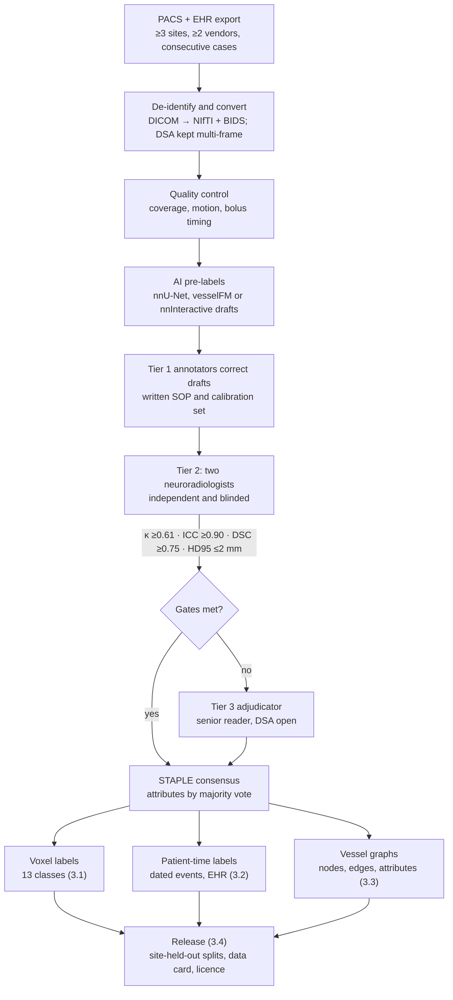

# Brain AVM and AI: Technical Review

## Scope and verification

The evidence base for bAVM AI is real but thin: small, single-centre, retrospective cohorts dominate, and no radiomics model had been externally validated as of the 2024 systematic review (13 studies, mean Radiomics Quality Score 15.9/36; [Grossen et al., *Front Neurol* 2024](https://doi.org/10.3389/fneur.2024.1398876)).

- **What was verified.** Every cited paper was matched to a publisher, PubMed/PMC, preprint or institutional-repository page; bibliographic fields that could not be confirmed there were omitted rather than guessed. Every GitHub repository in Module 4 was confirmed publicly readable on 14 Oct 2026.
- **Venue policy.** Priority goes to IEEE TMI, MedIA, Radiology, AJNR, Neurosurgery, the Lancet family and peer journals (Stroke, Neurology, J Neurosurg, BMJ, Nature Methods, JMRI, Eur Radiol). Much primary bAVM-AI evidence sits in Scientific Reports, Frontiers, Translational Stroke Research, IEEE Access or proceedings; it is cited only where it is the primary evidence, and the venue is always named.
- **Flags.** ‡ = preprint, not peer reviewed. † = peer-reviewed conference proceedings. Quartiles vary by category and year, so confirm them in JCR or SJR before formal submission.
- **Abbreviations.** SM, Spetzler–Martin; SRS, stereotactic radiosurgery; GKRS, Gamma Knife radiosurgery; RIC, radiation-induced changes; TDC, time–density curve; qDSA, quantitative DSA; DSC, Dice similarity coefficient; AUC, area under the ROC curve; CST, corticospinal tract.

## Module 1 — Clinical vs. AI datasets

Clinical decisions rest on DSA, but most bAVM models are trained on TOF-MRA, CTA and T2-weighted MRI, because those are 3D, standardised and exportable. The time-resolved modalities that carry the haemodynamic signal (2D/4D DSA, time-resolved MRA, 4D flow) remain under-used.

### 1.1 Modality map

| Modality | Primary clinical purpose | AI/ML utility (features extracted) | Data dimension & structure | Key evidence |
| --- | --- | --- | --- | --- |
| **Non-contrast CT** | First test in acute ICH: haematoma site, volume, intraventricular extension; calcification or hyperdense serpiginous vessels raise suspicion. No role in SM grading. | ICH detection; aetiology triage from haematoma radiomics (shape, first-order, GLCM/GLRLM texture). LASSO features plus age and calcification separated AVM-related from hypertensive haematomas (validation AUC 0.907, n = 571). | 3D, 0.5–5 mm slices (archives often hold 5 mm only); HU-calibrated; DICOM → NIfTI; window normalisation. | [Xie 2023, *Front Neurosci*](https://doi.org/10.3389/fnins.2023.1284560) |
| **CTA** (single phase ± delayed) | First-line search for a macrovascular ICH cause (yield 17%, PPV 72%; DSA found 15 further causes); nidus size and location for SM; SRS fusion. | Nidus segmentation; nidus radiomics (1,790 features + 8 clinical factors, stacking ensemble, rupture test AUC 0.893); patient-specific geometry for CFD of draining veins. | 3D, \~0.5–0.625 mm near-isotropic; one contrast phase, so arteries and early veins co-enhance; skull-base bone overlap; DICOM → NIfTI. | [van Asch 2015, *BMJ*](https://doi.org/10.1136/bmj.h5762); [Zhang 2024, *Transl Stroke Res*](https://doi.org/10.1007/s12975-023-01166-0); [Ma 2024, *Front Neurol*](https://doi.org/10.3389/fneur.2024.1474857) |
| **2D DSA** (biplane; colour-coded or quantitative) | Reference standard for feeders, nidus, venous drainage, venous stenosis/ectasia, intranidal and flow-related aneurysms; embolisation roadmap; stereotactic DSA for GKRS; confirms obliteration. | Phase detection and vessel-appearance order (Faster R-CNN + SVM, AVM vs non-AVM AUC 0.942); TDC parameters (TTP, MTT, FWHM, stasis index, lesion-filling index) for haemorrhage models (random forest test AUC 0.97); CNN–LSTM over frames; ICA separation of arterial, nidal and venous phases. | 2D+t: 512²–1024² frames, 1.5–6 fps, 12–50 frames per run; AP + lateral planes; DICOM XA multi-frame with mask frame; projected vessel overlap; TDCs depend on injection rate, catheter position and vendor post-processing. | [Joint Writing Group 2001, *Stroke*](https://doi.org/10.1161/01.STR.32.6.1430); [Strother 2010, *AJNR*](https://doi.org/10.3174/ajnr.A2020); [Shi 2021, *Front Neurol*](https://doi.org/10.3389/fneur.2021.655523); [Hong 2020, *IEEE Access*](https://doi.org/10.1109/ACCESS.2020.3036692); [Li 2024, *AJNR*](https://doi.org/10.3174/ajnr.A8218); [Wang 2023, *Electronics*](https://doi.org/10.3390/electronics12204241); [Baur 2024 ‡](https://arxiv.org/abs/2402.09636) |
| **3D rotational angiography** (3D-DSA) | 3D nidus shape, intranidal aneurysm localisation, embolisation working projections; SRS adjunct. | High-resolution vessel segmentation and skeletonisation; semi-automated nidus/artery/vein segmentation (quality good or fair in 93%; showed draining-vein ectasia better than 6 fps DSA). | 3D, sub-millimetre isotropic; single phase, so arteries, nidus and veins co-opacify; one injected territory per volume; DICOM (XA 3D or CT-like). | [Clarençon 2015, *Eur Radiol*](https://doi.org/10.1007/s00330-014-3421-5) |
| **4D DSA** (time-resolved 3D DSA) | Filling and draining sequence in 3D; intranidal aneurysms, fistulae, venous obstruction; best internal visualisation in a 6-AVM series. | Voxel-wise arrival-time labelling of arteries vs veins; natural input for 4D spatiotemporal networks (no bAVM AI study found). | 4D (x, y, z, t), up to 30 volumes/s reconstructed from one rotational run; vendor-proprietary reconstruction; rarely exported. | [Sandoval-Garcia 2016, *JNIS*](https://jnis.bmj.com/content/8/3/300) |
| **TOF-MRA** (3D) | Non-invasive diagnosis and surveillance; SRS fusion; follow-up after SRS until DSA confirms obliteration. | The most common DL training modality: U-Net nidus segmentation (DSC 0.80); radiomics (858 features, epilepsy AUC 0.82); input to multimodal SRS auto-contouring (DSC 0.84). | 3D, typically 0.3–0.6 mm in-plane, 0.5–1 mm slices; flow-dependent signal (slow venous flow saturates; subacute haematoma shines through); field-strength and vendor shift; DICOM → NIfTI. | [Jiao 2023, *AJNR*](https://doi.org/10.3174/ajnr.A7735); [Zhao 2021, *Front Neurol*](https://doi.org/10.3389/fneur.2021.767165); [Di 2025, *Front Neurosci*](https://doi.org/10.3389/fnins.2025.1645990) |
| **Time-resolved CE-MRA** (4D "DCE" MRA: keyhole, view sharing, HYPR) | SM grade matched DSA in 18/18 and 55/55 patients; post-operative residual filling matched in 25/25, but 7/100 small feeders were missed. HYPRFlow matched DSA SM grade in 13/14. | Bolus-arrival maps to separate arteries, nidus and veins; SVM nidus segmentation from 3D + 4D MRA (DSC 0.835 vs inter-observer 0.830); transit-time features. | 4D (x, y, z, t): 1.1–1.4 mm voxels at 572–608 ms/frame, or 0.68 mm isotropic at 0.75 s (HYPRFlow); \~50 dynamics; DICOM multi-phase. | [Hadizadeh 2008, *Radiology*](https://doi.org/10.1148/radiol.2453061684); [Hadizadeh 2012, *AJNR*](https://doi.org/10.3174/ajnr.A2921); [Chang 2015, *AJNR*](https://doi.org/10.3174/ajnr.A4245); [Forkert 2013, *IJCARS*](https://doi.org/10.1007/s11548-013-0823-9) |
| **4D flow MRI** (3D phase contrast, 3-direction velocity; dual-venc) | Research use: feeder and drainer velocity and flow, redistribution after staged embolisation; flow rises with SM grade while perinidal CBF/CBV fall. | Peak velocity, flow volume, pathline-derived feeding/draining patterns; flow-distribution network graphs; DL denoising and super-resolution (Module 2.3). | 5D: (x, y, z, t) × 3 velocity components + magnitude; 1.2–1.6 mm isotropic, 45 ms temporal; venc trade-off (fast feeders vs slow drainers); vendor DICOM or raw → .mat/.h5. | [Ansari 2013, *AJNR*](https://doi.org/10.3174/ajnr.A3537); [Markl 2013, *JMRI*](https://doi.org/10.1002/jmri.24261); [Wu 2015, *AJNR*](https://doi.org/10.3174/ajnr.A4259); [Aristova 2019, *JMRI*](https://pubmed.ncbi.nlm.nih.gov/31070849/) |
| **ASL** (continuous or pseudo-continuous) | Non-contrast detection of arteriovenous shunting (labelled signal in draining veins); residual shunt after treatment. | Venous ASL signal as a binary shunt label; perinidal perfusion and steal maps. | 3D or multi-slice 2D, \~3–4 mm voxels; label–control pairs (ΔM); NIfTI. | [Wolf 2008, *AJNR*](https://doi.org/10.3174/ajnr.A0901) |
| **SWI / T2\*-GRE** | Haemosiderin from prior or silent haemorrhage; venous hyperintensity marks shunting (sensitivity 93%, specificity 98%, κ 0.94 vs DSA). | Haemosiderin detection as a rupture-risk covariate (old haemorrhage HR 3.53 for new ICH); shunt-vein classification. | 3D, \~0.5–1 mm in-plane; complex magnitude + phase; NIfTI. | [Jagadeesan 2011, *Stroke*](https://doi.org/10.1161/STROKEAHA.110.584862); [Guo 2012, *Stroke*](https://doi.org/10.1161/STROKEAHA.111.647263) |
| **Structural MRI** (T2 flow voids, FLAIR, T1 MPRAGE ± gadolinium) | Eloquence and anatomy (SM "E"); haemorrhage staging; SRS target fusion; RIC surveillance after SRS. | T2 fuzzy c-means vessel/brain/CSF decomposition: compactness index predicts obliteration (209 AVMs), intervening parenchyma predicts RIC; DL RIC segmentation (DSC 0.718); multiparametric CNN labelling arteries, veins and embolised vessels (DSC 0.75–0.98). | 3D 1 mm isotropic (MPRAGE) or 2D 3–5 mm slices (T2, FLAIR); anisotropic spacing needs resampling; NIfTI. | [Huang 2023, *J Neurosurg*](https://doi.org/10.3171/2022.4.JNS212369); [Lee 2019, *World Neurosurg*](https://doi.org/10.1016/j.wneu.2018.12.220); [Ho 2025, *BMC Med Imaging*](https://doi.org/10.1186/s12880-025-01796-w); [Simon 2022, *Sci Rep*](https://doi.org/10.1038/s41598-021-04466-3) |
| **DTI tractography, fMRI** | Eloquence mapping for surgery and SRS; BOLD reliability near AVMs is questioned. | AVM–CST distance and fibre counts in 10–50 mm shells (motor-deficit AUC 0.86–0.88); white-matter tract dose in SRS planning. | DTI 4D (x, y, z, gradient direction; 30 directions in Jiao 2023) with bvec/bval; fMRI 4D BOLD; tractograms (.trk/.tck). | [Jiao 2023, *AJNR*](https://doi.org/10.3174/ajnr.A7735); [Lehéricy 2002, *Radiology*](https://doi.org/10.1148/radiol.2233010792); [Di 2025, *Front Neurosci*](https://doi.org/10.3389/fnins.2025.1645990) |

### 1.2 Where clinical and AI datasets diverge

| Clinical stage | Clinical reference modality | Modality in AI cohorts | Consequence for model development |
| --- | --- | --- | --- |
| Detection in acute ICH | NCCT → CTA → delayed MRI/MRA → DSA | NCCT radiomics, CTA | CTA misses small or haematoma-compressed lesions; positive labels need best-evidence follow-up (1 year in DIAGRAM). |
| SM grading | DSA + MRI for eloquence | TOF-MRA, CTA, 4D CE-MRA | Single-phase volumes under-call deep drainage and small feeders; time-resolved MRA recovers most of them. |
| Surgical planning | DSA + MRI + DTI/fMRI | TOF + DTI ([Jiao 2023](https://doi.org/10.3174/ajnr.A7735)) | CST proximity is learnable; fMRI near the nidus is weak ground truth. |
| Embolisation | 2D DSA, 3D-DSA roadmaps | 2D DSA sequences, qDSA | Frame rate, projection and injection vary per run; embolic casts degrade later segmentation (lowest DSC 0.75 in [Simon 2022](https://doi.org/10.1038/s41598-021-04466-3)). |
| SRS planning | Stereotactic DSA + T1/T2/TOF (GKRS) or CT + MRI (CyberKnife) | TOF + FLAIR + MPRAGE + CT ([Di 2025](https://doi.org/10.3389/fnins.2025.1645990)) | The nidus boundary is uncertain: inter-observer DSC was 0.830 in [Forkert 2013](https://doi.org/10.1007/s11548-013-0823-9), and categorical angioarchitecture reads vary ([Iancu-Gontard 2007, *AJNR*](https://www.ajnr.org/content/28/3/524)). |
| Follow-up and obliteration | MRI/MRA surveillance; DSA confirms obliteration | T2/FLAIR (RIC), TOF | Obliteration labels need DSA years after treatment (median latency 43.3 months in [Huang 2023](https://doi.org/10.3171/2022.4.JNS212369)). |

## Module 2 — AI applications in bAVM

Segmentation is the most mature task (nidus DSC 0.80–0.84, close to inter-observer agreement); detection and haemodynamic learning are early, and outcome models are almost all internally validated (one SRS model was tested on a held-out institution).

### 2.1 Automated detection and screening

No externally validated detector for *incidental* bAVM on routine head CT or MRI was found. Published "detection" runs inside AVM-enriched radiosurgery or angiography cohorts, so specificity in an unselected screening population is unknown.

| Study | Modality & cohort | Architecture | Reported performance | Main limitation |
| --- | --- | --- | --- | --- |
| [Hong 2024, *JMRI*](https://doi.org/10.1002/jmri.28795) | 1.5 T 3D TOF-MRA; 221 radiosurgery patients (177/22/22 split) | YOLOv5/YOLOv8 slice-wise detection, then U-Net/U-Net++ nidus segmentation inside randomly dilated boxes; pretraining + augmentation | Best nidus DSC 0.82 on detected test lesions | Single centre; 22 test patients; AVM-positive cohort |
| [Shi 2021, *Front Neurol*](https://doi.org/10.3389/fneur.2021.655523) | AP 2D DSA runs; 305 patients (152 AVM, 153 non-AVM); single centre | Faster R-CNN tracks 5 vascular structures per frame → 5 phase-order features + 1,750 radiomic features from 5 sampled frames → sparse selection + SVM | AVM vs non-AVM test AUC 0.942; SM I–III vs IV–V AUC 0.871 | AP view only; lesions overlapping key structures excluded |
| [Xie 2023, *Front Neurosci*](https://doi.org/10.3389/fnins.2023.1284560) | NCCT; 571 ICH patients (297 AVM-related, 274 hypertensive) | 1,688 haematoma radiomic features → LASSO (67) → SVM or logistic regression ± age, calcification | Combined validation AUC 0.896 (SVM), 0.907 (LR) | Two-cause problem; random split; semi-automatic masks |
| *Transferable:* [Sohn 2021, *AJNR*](https://doi.org/10.3174/ajnr.A7242) | TOF-MRA aneurysms; developed on 600 patients, external test 110; reader study 332 exams | 3D ResNet patch classifier + voxel voting → 1 cm boxes | Reader sensitivity 73.5% → 86.5% with assistance | Enriched prevalence |
| *Transferable:* [ADAM challenge, Timmins 2021, *NeuroImage*](https://researchinformation.umcutrecht.nl/en/publications/comparing-methods-of-detecting-and-segmenting-unruptured-intracra/) | TOF-MRA + structural MRI; 113 training / 141 test cases | 11 detection and 9 segmentation teams | Top segmentation ≈ inter-observer after excluding false detections | Aneurysms, not AVMs |
| *Transferable:* [RSNA Intracranial Aneurysm Detection 2025](https://www.rsna.org/artificial-intelligence/ai-image-challenge/intracranial-aneurysm-detection-ai-challenge) | CTA, MRA and MRI from 18 sites on 5 continents; 60 radiologists labelled 13 locations | Winning entry used Skeleton Recall loss in nnU-Net ([repo](https://github.com/MIC-DKFZ/Skeleton-Recall)) | Leaderboard on Kaggle | Non-commercial licence |

Upstream ICH triage on NCCT is mature ([Chilamkurthy 2018, *Lancet*](https://research.google/pubs/deep-learning-algorithms-for-detection-of-critical-findings-in-head-ct-scans-a-retrospective-study/); [RSNA 2019 ICH dataset, Flanders 2020, *Radiol AI*](https://doi.org/10.1148/ryai.2020190211)), so the realistic deployment is a cascade: ICH detection → aetiology triage → CTA or MRA lesion localisation.

**Backbones**

- **2D detectors on slices or frames** (YOLO, Faster R-CNN) dominate bAVM work because box labels are cheap and cohorts are small; they discard through-plane context.
- **3D CNN patch classifiers and segmentation-as-detection** (3D ResNet, 3D U-Net, nnU-Net) are standard for TOF-MRA aneurysm detection and transfer directly; connected components of a 3D mask give lesion-level detections.
- **Transformers** (UNETR, Swin-UNETR): no bAVM detector was found. A MICCAI 2024 benchmark found well-configured CNN U-Nets (ResNet/ConvNeXt variants in nnU-Net) beat claimed Transformer and Mamba gains when trained from scratch ([Isensee 2024 †](https://doi.org/10.1007/978-3-031-72114-4_47)).

**Dataset challenges**

- **Spectrum bias:** positives come from radiosurgery or angiography series; true negatives from unselected scans are absent, so screening false-positive rates are unmeasured.
- **Mimics:** dural AV fistula, developmental venous anomaly, cavernoma, hypervascular tumours and moyamoya collaterals share flow voids or early venous filling.
- **Haematoma masking:** acute haematoma compresses small niduses; CTA's PPV was 72% and DSA found 15 causes CTA missed ([van Asch 2015](https://doi.org/10.1136/bmj.h5762)).
- **Acquisition shift:** 1.5 T vs 3 T TOF, CTA bolus timing, and DSA projection choice change lesion appearance.

### 2.2 Lesion segmentation and volumetry

Nidus segmentation reaches DSC 0.80–0.84 on TOF-MRA and multimodal MRI, about the inter-observer level (0.83). Separate feeder and drainer labels remain rare: Forkert 2013 classified them automatically from 4D MRA timing, while Simon 2022 segmented arteries and veins (DSC 0.86, 0.91) without that distinction.

| Study | Modality & cohort | Method | Labels | Result |
| --- | --- | --- | --- | --- |
| [Forkert 2013, *IJCARS*](https://doi.org/10.1007/s11548-013-0823-9) | 3D MRA + 4D time-resolved MRA; 15 patients | Vessel segmentation → voxel-wise SVM (4 features) → nidus by volume growing; 4D haemodynamics classify vessels | Nidus, feeders, drainers | Nidus DSC 0.835 vs inter-observer 0.830 |
| [Clarençon 2015, *Eur Radiol*](https://doi.org/10.1007/s00330-014-3421-5) | 3D rotational angiography; 15 patients | Semi-automated tag propagation from a reference slice + density/variance contiguity propagation | Nidus, arteries, veins | Good or fair in 93%; 64 ± 26 min per case |
| [Simon 2022, *Sci Rep*](https://doi.org/10.1038/s41598-021-04466-3) | Multiparametric MRI/MRA; 23 SRS patients (17 train, 6 validation) | CNN on hybrid semi-automated + manual labels | Arteries, veins, parenchyma, CSF, embolised vessels | DSC 0.86, 0.91, 0.98, 0.91, 0.75 |
| [Jiao 2023, *AJNR*](https://doi.org/10.3174/ajnr.A7735) | 3 T TOF-MRA; 83 surgical patients | U-Net | Nidus | DSC 0.80 |
| [Hong 2024, *JMRI*](https://doi.org/10.1002/jmri.28795) | 1.5 T TOF-MRA; 221 patients | YOLO localisation → U-Net++ with random box dilation | Nidus | DSC 0.82 |
| [Di 2025, *Front Neurosci*](https://doi.org/10.3389/fnins.2025.1645990) | TOF + FLAIR + MPRAGE + planning CT + DTI tractography; 191 CyberKnife patients (153/38) | 2D U-Net localiser → 128³ ROI → 3D self-attention network (spatial + channel attention, depthwise-separable convolutions, IoU + Dice loss) | Nidus; WM tracts for dose | DSC 0.84 ± 0.05 vs nnU-Net 0.79, U-Net 0.76; plan agreement R² 0.92 (WM Dmean) |
| [Lee 2019, *World Neurosurg*](https://doi.org/10.1016/j.wneu.2018.12.220); [Huang 2023, *J Neurosurg*](https://doi.org/10.3171/2022.4.JNS212369); [Lin 2024, *J Med Biol Eng*](https://hub.tmu.edu.tw/en/publications/using-gaussian-mixture-model-clustering-for-the-automated-segment/) | T2-weighted MRI; 25–209 AVMs | Unsupervised fuzzy c-means, k-means, Gaussian mixture | Vessel, parenchyma, CSF inside nidus | FCM DSC 0.795 vs manual; GMM brain-tissue DSC 0.826 |
| [Ho 2025, *BMC Med Imaging*](https://doi.org/10.1186/s12880-025-01796-w) | Serial T2 after SRS; 28 patients, 139 scans | Mask R-CNN ROI → DeepMedic (transfer learning) | Radiation-induced changes | DSC 0.718 |
| [3DRA vessel model, 2022 ‡](https://arxiv.org/abs/2210.02416) | 3D rotational angiography; 5 annotated volumes | Two 3D U-Net variants | Vessels | Recovered veins missing from the labels |

Earlier work also segmented contrast-enhanced CT for SRS ([Wang 2019, *Med Phys*](https://pubmed.ncbi.nlm.nih.gov/31050804/)). A 2022 review of 33 segmentation studies found MRI in 39%, DSA in 27% and CT in 21%, with automatic methods in 61% ([Colombo 2022, *Radiol Med*](https://doi.org/10.1007/s11547-022-01567-5)). Two further reviews were identified but could not be read here: a 2025 *Neuroradiology* systematic review ([PubMed 41240100](https://pubmed.ncbi.nlm.nih.gov/41240100/)) and a 2026 *Radiation Oncology* multi-reader study ([PubMed 41772699](https://pubmed.ncbi.nlm.nih.gov/41772699/)).

**How multimodal fusion is executed**

1. **Align first.** Di 2025 registered MRI and DTI to the planning CT; Jiao 2023 carried tracts through ICBM-152 atlas space onto TOF-MRA. Intra-patient brain alignment is usually rigid or affine ([elastix, *IEEE TMI* 2010](https://doi.org/10.1109/TMI.2009.2035616); [ANTs, *NeuroImage* 2011](https://pmc.ncbi.nlm.nih.gov/articles/PMC3065962)); learned deformable registration ([VoxelMorph, *IEEE TMI* 2019](https://doi.org/10.1109/TMI.2019.2897538)) helps when haematoma or surgery deforms anatomy.
2. **Early fusion.** Co-registered volumes enter one 3D network as channels. Simon 2022 and Di 2025 both feed several co-registered sequences into one model; neither abstract details the fusion layer.
3. **Intermediate or late fusion.** Modality-specific encoders merge at the bottleneck or by cross-attention. This tolerates missing sequences, which are common because bAVM protocols vary by centre and treatment stage.
4. **Time-to-space transfer.** 4D MRA arrival times label vessels segmented on 3D MRA ([Forkert 2013](https://doi.org/10.1007/s11548-013-0823-9)); a 4D DSA volume at maximal shunting has been fused with 3D FLAIR for neuronavigation ([Guihard 2021, *Neurosci Inform*](https://doaj.org/article/08da2153504b491f972024ac302e2e0b)).

**Volumetry.** Nidus volume enters VRAS directly (2–4 cm³ scores 1 point, >4 cm³ scores 2; [Starke 2013, *J Neurosurg*](https://doi.org/10.3171/2013.5.JNS1311)). A 10% volume error near 4 cm³ can therefore change a patient's score, so benchmarks should report absolute and relative volume error and HD95 alongside DSC. Size for SM grading needs the maximal diameter, which masks give as a Feret diameter ([Zhang 2022, *Front Neurol*](https://doi.org/10.3389/fneur.2022.979014)).

**Dataset challenges**

- **Ambiguous boundary:** expert masks agree at DSC 0.83, and categorical angioarchitecture reads vary between and within observers ([Iancu-Gontard 2007, *AJNR*](https://www.ajnr.org/content/28/3/524)).
- **Foreground imbalance:** a 3 cm³ nidus is about 0.2% of a 1,400 cm³ intracranial volume, so voxel losses reward under-segmentation.
- **Topology:** thin, tortuous, looping vessels fragment under voxel losses; topology-aware losses such as [clDice †](https://arxiv.org/abs/2003.07311) and [Skeleton Recall †](https://arxiv.org/abs/2404.03010) target connectivity (Module 4).
- **Embolic casts and clips:** the embolised-vessel class had the lowest DSC (0.75) in Simon 2022.
- **Small, single-centre cohorts:** 5–221 patients per study; SM IV–V lesions are scarce (8 grade IV training cases in Di 2025).
- **Multi-site shift:** an 8-centre TOF-MRA benchmark needed a style self-consistency loss to cope with vendor and site styles ([COSTA, *IEEE TMI* 2024](https://doi.org/10.1109/TMI.2024.3424976)).

### 2.3 Haemodynamic and spatiotemporal analysis

bAVM haemodynamic models still mostly compress 2D DSA into hand-crafted time–density features. Spatiotemporal deep networks and 4D flow learning are proven in adjacent cerebrovascular tasks but barely applied to bAVM.

**2D DSA: from time–density curves to sequence models**

| Study | Data | How time is encoded | Model | Result |
| --- | --- | --- | --- | --- |
| [Strother 2010, *AJNR*](https://doi.org/10.3174/ajnr.A2020) | 26 clinical 2D-DSA runs | Per-pixel timing and intensity collapsed into one colour-coded composite | Parametric imaging | Treatment evaluation easier in >40% of cases |
| [Zhu 2023, *Front Neurol*](https://doi.org/10.3389/fneur.2023.1174245) | 104 untreated patients, 350.4 person-years | Pixel-wise TDC maps → nidus CBF, CBV, TTP, MTT, stasis index | Cox regression | Nidus CBV HR 3.35, stasis index HR 1.54; annual rupture risk 3.7% |
| [Li 2024, *AJNR*](https://doi.org/10.3174/ajnr.A8218) | 180 patients; qDSA (syngo iFlow) + MRI volume | TTP, MTT, FWHM, arterial diagnostic window (ADW), transnidal velocity, stasis index; lesion-filling index = ADW / nidus volume | Logistic regression; added to R2eD and VALE | LFI lifted VALE AUC 0.603 → 0.706; R2eD gain not significant |
| [Hong 2020, *IEEE Access*](https://doi.org/10.1109/ACCESS.2020.3036692) | Quantitative DSA features | χ², mRMR, ReliefF and t-test selection | Random forest, naïve Bayes, SVM with Bayesian tuning | RF test AUC 0.97 (accuracy 85.7%) vs radiologists ≤76.2% |
| [Chen KK 2023, *Stroke Vasc Interv Neurol*](https://doaj.org/article/dcb0a10e9505448bae75c2567776348e) | 24 patients; DSA and phase-contrast MRI | Velocities along calibrated centrelines; summed feeder flow ÷ nidus volume = nidus flow index | Wilcoxon + SVM | DSA index higher with haemorrhage (P = 0.027); PC-MRI index not significant |
| [Zhang 2025, *JNIS*](https://jnis.bmj.com/content/17/2/186) | 10 AVMs; microcatheter pressure + colour-coded DSA | Transnidal pressure gradient vs DSA stasis index | Correlation | Gradient 53.0 vs 39.3 mmHg (ruptured vs unruptured); r = 0.681 with stasis index |
| [Shi 2021, *Front Neurol*](https://doi.org/10.3389/fneur.2021.655523) | 305 AP DSA runs | Per-frame detections → 5-phase appearance order | Faster R-CNN + SVM | AVM diagnosis AUC 0.942 |
| [Wang 2023, *Electronics*](https://doi.org/10.3390/electronics12204241) | 147 patients; AP + lateral DSA | Per-frame CNN features → LSTM | CNN–RNN | Haemorrhage AUC 0.748 vs 0.757 for angioarchitecture regression; 100% training accuracy (overfit) |
| [Baur 2024 ‡](https://arxiv.org/abs/2402.09636) | 19 series, 10 patients, 1.5–6 fps | FastICA splits arterial, nidal and venous sources; phase order from time of maximum | MobileNetV2 U-Net vessel mask + ICA overlay | Vessel DSC 0.944 |
| *Transferable:* [DIAS 2024, *MedIA*](https://doi.org/10.1016/j.media.2024.103247) | Public intracranial DSA sequences | Sequence feature-extraction module over 2D+t | Full, scribble (cross pseudo-supervision) and semi-supervised baselines | Open data and code |
| *Transferable:* [autoTICI 2021, *IEEE TMI*](https://doi.org/10.1109/TMI.2021.3077113) | Multi-centre stroke DSA | Multi-path CNN classifies frames (non-contrast, arterial, parenchymal, venous) with a state-transition matrix → MINIP | Pixel classification | AUC 0.81 vs eTICI (0.90 dichotomised) |
| *Transferable:* [Su 2022, *MedIA*](https://doi.org/10.1016/j.media.2022.102377) | MR CLEAN Registry, MR CLEAN-NoIV, HERMES | Single-frame detectors + temporal modules for contrast extravasation | Spatiotemporal detection | Series AUC 0.93; precision 0.83, recall 0.70 |
| *Transferable:* [Ueda 2021, *Radiology*](https://doi.org/10.1148/radiol.2021203692) | 40 patients; 15,592 paired frames | Mask-free generation of DSA-like frames | Image-to-image network | PSNR 40.2 dB, SSIM 0.97; removes misregistration that corrupts TDCs |

**Time-resolved 3D and 4D flow**

- **4D CE-MRA:** HYPRFlow measured arterial transit of 0.49 s on the AVM side vs 2.53 s contralaterally, and 3.86 mL/s in the largest feeder ([Chang 2015, *AJNR*](https://doi.org/10.3174/ajnr.A4245)). 4D MRA arrival times classified feeders and drainers ([Forkert 2013](https://doi.org/10.1007/s11548-013-0823-9)).
- **4D DSA:** up to 30 time-resolved volumes per second ([Sandoval-Garcia 2016](https://jnis.bmj.com/content/8/3/300)); no bAVM learning study was found.
- **4D flow MRI physiology:** velocity redistribution after staged embolisation ([Ansari 2013](https://doi.org/10.3174/ajnr.A3537); [Markl 2013, *JMRI*](https://doi.org/10.1002/jmri.24261)); feeder flow rising with SM grade as perinidal CBF and CBV fall ([Wu 2015](https://doi.org/10.3174/ajnr.A4259)); dual-venc flow-distribution network graphs ([Aristova 2019, *JMRI*](https://pubmed.ncbi.nlm.nih.gov/31070849/)).
- **4D flow deep learning (transferable):** a residual network trained on CFD-synthesised pairs for super-resolution ([4DFlowNet 2020, *Front Phys*](https://doi.org/10.3389/fphy.2020.00138)); cerebrovascular super-resolution followed by physics-informed estimation of velocity, flow and relative pressure ([Ferdian 2023, *MedIA*](https://www.sciencedirect.com/science/article/abs/pii/S1361841523000919)); a CNN trained on patient-specific CFD that cut noise and velocity error and sharpened near-wall flow in 20 patients ([Rutkowski 2021, *Sci Rep*](https://doi.org/10.1038/s41598-021-89636-z)).
- **Physics models as label generators:** a patient-specific intranidal flow model for embolisation planning recovered 22 of 24 main flow paths ([Orlowski 2011, *IEEE TBME*](https://doi.org/10.1109/TBME.2011.2119317)); steady CFD of draining veins (CTA geometry, qDSA inlet velocities) found higher pressure and posterior-segment wall shear stress in ruptured AVMs ([Ma 2024](https://doi.org/10.3389/fneur.2024.1474857)).

**How models capture time and velocity**

1. **Parametric reduction:** each pixel's TDC becomes TTP, MTT, FWHM or CBV maps, used as features or 2D CNN input. Interpretable, but injection-dependent.
2. **Frame encoder + sequence model:** a 2D CNN per frame feeds an LSTM, GRU or temporal convolution (Wang 2023).
3. **2D+t as a volume:** 3D convolutions over (x, y, t), or dedicated sequence feature modules (DIAS).
4. **Phase-structured inference:** frames are classified into phases under a state-transition prior, then pooled by MINIP or MIP (autoTICI); detection-derived phase order is a lighter variant (Shi 2021).
5. **Source separation:** ICA or NMF splits arterial, nidal and venous components without labels (Baur 2024).
6. **Velocity fields:** each 4D flow voxel carries (vx, vy, vz) plus magnitude per cardiac phase; networks process 3D patches per phase with three velocity channels, trained on CFD pairs. 4DFlowNet v2 uses separate fluid and non-fluid MSE terms with the divergence loss switched off ([repo](https://github.com/EdwardFerdian/4DFlowNet)).
7. **Graph reduction:** flow-distribution network graphs summarise inflow and outflow per vessel segment (Aristova 2019), a natural input for graph networks (Module 3.3).

**Dataset challenges**

- **Temporal undersampling:** AVM arterial transit is about 0.5 s (0.49 s in Chang 2015), while clinical DSA runs at 1.5–6 fps (one frame every 0.17–0.67 s). Nidal transit therefore spans roughly 1–3 frames.
- **Injection dependence:** TDCs change with injection rate, volume, catheter position and vendor processing, so features shift between centres and runs.
- **Projection overlap:** 2D DSA superimposes feeders, nidus and drainers; both Li 2024 and Zhu 2023 list it as a limitation.
- **Post-rupture alteration:** haemodynamics were measured after admission (Li 2024), and rupture may alter nidal flow (Zhu 2023).
- **4D flow limits:** 1.2–1.6 mm voxels are coarse against sub-millimetre nidal channels; one venc cannot serve fast feeders and slow drainers, hence dual-venc.
- **Scarce physical ground truth:** invasive pressure exists for 10 AVMs (Zhang 2025); CFD labels inherit steady-flow and boundary-condition assumptions.

### 2.4 Treatment outcome and rupture-risk prediction

Rupture models still rest on a few natural-history predictors: prior haemorrhage (HR 3.86), age (HR 1.34 per decade) and possibly exclusive deep drainage (HR 1.60). Imaging AI adds modest, internally validated gains, and post-rupture imaging confounds most training labels.

| Endpoint | Study | Inputs | Fusion and model | Performance | Validation |
| --- | --- | --- | --- | --- | --- |
| Haemorrhage, natural history | [Kim 2014, *Neurology*](https://doi.org/10.1212/WNL.0000000000000688) | 2,525 patients, 4 cohorts, 6,074 patient-years | Cox on clinical + angioarchitectural factors | Annual rate 2.3% (4.8% ruptured vs 1.3% unruptured at presentation) | Pooled patient-level data |
| Haemorrhagic presentation | [R2eD, Feghali 2019, *Stroke*](https://www.ahajournals.org/doi/10.1161/STROKEAHA.119.025054) | Clinical + angioarchitectural factors | Points score | Common comparator | See source |
| Rupture, CTA radiomics | [Zhang 2024, *Transl Stroke Res*](https://doi.org/10.1007/s12975-023-01166-0) | 586 patients (368 haemorrhagic); 1,790 radiomic + 8 clinical features | L1 selection (241) → stacking ensemble (LR base, RF meta) | Test AUC 0.893 (train 0.982) | Internal split |
| Rupture, CTA morphology | [Zhang 2022, *Front Neurol*](https://doi.org/10.3389/fneur.2022.979014) | 412 patients; volume, Feret diameter, surface area, density + angioarchitecture | L1 logistic nomogram | C-index 0.873 train, 0.754 test | Internal split |
| Haemorrhagic bAVM, qDSA | [Hong 2020, *IEEE Access*](https://doi.org/10.1109/ACCESS.2020.3036692) | Quantitative DSA features | Random forest | Test AUC 0.97 | Independent test set |
| Haemorrhagic bAVM, DSA video | [Wang 2023, *Electronics*](https://doi.org/10.3390/electronics12204241) | AP + lateral DSA, 147 patients | CNN–LSTM | AUC 0.748 | 29-patient test |
| Rupture association, qDSA | [Li 2024, *AJNR*](https://doi.org/10.3174/ajnr.A8218) | Lesion-filling index + R2eD or VALE | Score augmentation | VALE AUC 0.603 → 0.706 | 10-fold CV |
| Subsequent haemorrhage | [Zhu 2023, *Front Neurol*](https://doi.org/10.3389/fneur.2023.1174245) | DSA parametric maps + clinical | Cox | Nidus CBV HR 3.35; stasis index HR 1.54 | Longitudinal, single centre |
| Subsequent haemorrhage | [Guo 2012, *Stroke*](https://doi.org/10.1161/STROKEAHA.111.647263) | Imaging evidence of old haemorrhage (+ histology) | Cox | HR 3.53 for new ICH | 643 patients |
| SRS outcome | [Oermann 2016, *Sci Rep*](https://doi.org/10.1038/srep21161) | 1,810 patients, 3 prospective databases; 23 features incl. 3D surface dose | Feature engineering + optimised ML | Mean AUC 0.71 vs 0.63 for clinical grading systems | Held-out institution |
| SRS obliteration and RIC | [Huang 2023, *J Neurosurg*](https://doi.org/10.3171/2022.4.JNS212369) | T2 fuzzy c-means compactness index + volume + drainage; 209 unruptured AVMs | Multivariable regression | Compact morphology, smaller volume, superficial drainage → obliteration (82.8% overall); diffuse → RIC | Retrospective cohort |
| SRS outcome, clinical baseline | [VRAS, Starke 2013, *J Neurosurg*](https://doi.org/10.3171/2013.5.JNS1311) | Volume, eloquence, haemorrhage history | Points | Favourable outcome 80%, 70%, 45% for 0–1, 2, 3–4 points | 1,012 patients |
| Motor deficit after surgery | [Jiao 2023, *AJNR*](https://doi.org/10.3174/ajnr.A7735) | U-Net TOF nidus + DTI CST fibre counts in 10–50 mm shells + clinical | LASSO → logistic regression (fibre count + SM + diffuseness) | AUC 0.88 (fibre count alone 0.86; SM grade 0.61) | Nested 10×5 CV, 50 repeats |
| Epilepsy | [Zhao 2021, *Front Neurol*](https://doi.org/10.3389/fneur.2021.767165) | TOF radiomics (858 → 15) + age, size, frontal lobe | Rad-score + clinical nomogram | AUC 0.82 | 5-fold CV |
| Embolisation complications | [Sato 2020, *AJNR*](https://doi.org/10.3174/ajnr.A6470) | JR-NET3: 1,042 procedures, 788 patients, 111 centres | Multivariable logistic | Complications 13.1%; infratentorial location independent | Registry; no imaging AI |

Identified but not read here: a 2025 *J Neurosurg* external validation of rupture scores ([link](https://thejns.org/view/journals/j-neurosurg/143/2/article-p490.xml)), a 2023 *Acad Radiol* model on clinical and angioarchitectural features ([PubMed 37783607](https://pubmed.ncbi.nlm.nih.gov/37783607/)) and a haemodynamics-based interpretable rupture model ([PubMed 41449311](https://pubmed.ncbi.nlm.nih.gov/41449311/)).

**How imaging and clinical data are combined**

1. **Concatenation into penalised models or ensembles:** radiomic and clinical vectors are pooled before L1 selection (Zhang 2024).
2. **Rad-score plus clinical nomogram:** a LASSO radiomics score enters a logistic model beside clinical risk factors (Zhao 2021).
3. **Score augmentation:** one imaging biomarker is added to an established score and judged by AUC change (Li 2024).
4. **Imaging-derived scalars:** segmentation and tractography yield interpretable covariates such as CST fibre counts or a compactness index (Jiao 2023; Huang 2023).
5. **Time-to-event modelling:** Cox models handle variable follow-up (Kim 2014; Guo 2012; Zhu 2023).
6. **Not yet reported for bAVM:** end-to-end deep fusion of image embeddings with tabular EHR data (late concatenation, FiLM conditioning or cross-attention) under a survival loss. Module 3.2 specifies the data such a model needs.

**Dataset challenges**

- **Label leakage:** ruptured-vs-unruptured classifiers mostly learn from post-rupture imaging, where haematoma, compression and altered flow encode the label (both Li 2024 and Zhu 2023 flag this).
- **Treatment interrupts natural history:** for unruptured AVMs the ARUBA trial favoured medical management ([*Lancet* 2014](<https://www.thelancet.com/journals/lancet/article/PIIS0140-6736(13)62302-8/abstract>); [final follow-up, *Lancet Neurol* 2020](<https://www.thelancet.com/journals/laneur/article/PIIS1474-4422(20)30181-2/abstract>)); intervention must be modelled as censoring or a competing event.
- **Event sparsity:** at 1.3% per year, 500 unruptured patients followed for 3 years yield about 20 haemorrhages.
- **Overfitting:** training–test gaps of 0.982 → 0.893 AUC (Zhang 2024) and 100% training accuracy (Wang 2023).
- **No external validation:** none of 13 radiomics studies had one ([Grossen 2024](https://doi.org/10.3389/fneur.2024.1398876)).
- **Treatment-state confounding:** prior embolisation and SRS reshape angioarchitecture; complete or near-complete obliteration followed 37% of embolisation procedures in JR-NET3, so many "pre-SRS" scans are post-embolisation.

### 2.5 Cross-cutting dataset challenges

The same eight data problems recur across all four tasks; Module 3 is built to remove them at collection time rather than patch them in modelling.

| Challenge | How it shows up in bAVM data | Evidence | Mitigation (Module 3) |
| --- | --- | --- | --- |
| Small, single-centre cohorts | 5–221 patients per segmentation study; no externally validated radiomics model | [Grossen 2024](https://doi.org/10.3389/fneur.2024.1398876); Module 2.2 table | Multi-site consortium; site-held-out test set; confidence intervals on every metric |
| Voxel and event imbalance | Nidus ≈0.2% of intracranial volume; 1.3% annual haemorrhage in unruptured AVMs | [Kim 2014](https://doi.org/10.1212/WNL.0000000000000688) | Region and topology losses; survival framing; report PR-AUC and calibration |
| Tortuous, looping topology | Fragmented feeders and drainers under voxel losses | [clDice †](https://arxiv.org/abs/2003.07311); [Skeleton Recall †](https://arxiv.org/abs/2404.03010) | Centreline labels; Betti-number and clDice metrics; graph QA (3.3) |
| Reference-standard mismatch | MRA and CTA labels miss small feeders (7 of 100 on 4D MRA) | [Hadizadeh 2012](https://doi.org/10.3174/ajnr.A2921) | DSA-adjudicated labels; per-structure confidence flags |
| Inter-observer variability | Expert nidus masks agree at DSC 0.83; categorical reads vary | [Forkert 2013](https://doi.org/10.1007/s11548-013-0823-9); [Iancu-Gontard 2007](https://www.ajnr.org/content/28/3/524) | Multi-reader masks fused with STAPLE; κ thresholds (3.1) |
| Multi-site domain shift | Vendor and field-strength styles in TOF; injection-dependent DSA curves | [COSTA 2024](https://doi.org/10.1109/TMI.2024.3424976); Module 2.3 | Acquisition metadata; harmonisation; leave-one-site-out evaluation |
| Rupture and treatment confounding | Post-rupture imaging; embolic casts (lowest DSC 0.75) | [Simon 2022](https://doi.org/10.1038/s41598-021-04466-3); [Sato 2020](https://doi.org/10.3174/ajnr.A6470) | Time-stamped treatment state per scan; pre-rupture index scans (3.2) |
| Data access | No public bAVM imaging benchmark found; public DSA data cover stroke and normal arteries | Module 4 | Benchmark release with licence, de-identification and data card |

## Module 3 — Benchmark data and annotation blueprint

A benchmark that removes the failures in Module 2 needs DSA-adjudicated, multi-reader, multi-site labels at three levels (voxel, patient-over-time, vessel graph), each stored with acquisition and treatment-state metadata.

*Figure — benchmark curation and annotation pipeline (12 steps, 1 gate).*

Readers correct AI drafts rather than drawing from scratch; only cases that fail a gate go to the adjudicator, and the fused labels feed all three label layers.

### 3.0 Curation pipeline shared by all approaches

1. **Cohort design.** Consecutive inclusion from ≥3 sites and ≥2 vendors. For detection, add AVM-negative scans and mimics (developmental venous anomaly, dural AV fistula, cavernoma, hypervascular tumour). Hold out at least one whole site as the external test set.
2. **De-identification.** Apply the DICOM confidential profile, scrub text burned into DSA pixel data, and deface 3D T1/FLAIR: face renders from research MRI have re-identified participants with face-recognition software ([Schwarz 2019, *NEJM*](https://doi.org/10.1056/NEJMc1908881)).
3. **Conversion and layout.** Convert to NIfTI with JSON sidecars ([dcm2niix; Li 2016, *J Neurosci Methods*](https://doi.org/10.1016/j.jneumeth.2016.03.001)) in a BIDS-style tree ([Gorgolewski 2016, *Sci Data*](https://doi.org/10.1038/sdata.2016.44)). Keep DSA as multi-frame DICOM with frame times, and 4D flow with raw phase data and venc.
4. **Metadata.** Scanner, field strength, sequence parameters and contrast agent; for DSA, injection site, rate and volume; for every scan, days from the index haemorrhage and the treatment state.
5. **Quality control.** Whole nidus and venous outflow to the sinus in the field of view; motion; bolus timing; DSA misregistration, with mask-free generation as a fallback ([Ueda 2021](https://doi.org/10.1148/radiol.2021203692)).
6. **Pre-annotation.** nnU-Net, vesselFM or nnInteractive drafts that readers correct instead of drawing from scratch (Module 4).

### 3.1 Semantic segmentation (voxel level)

Voxel labels should be drawn on the highest-resolution 3D volume and adjudicated against DSA, with separate classes for nidus, feeders, drainers and the angioarchitectural risk features.

**Data specifications**

| Modality | Minimum specification | Rationale |
| --- | --- | --- |
| CTA | ≤0.625 mm slices, ≤0.5 mm reconstruction increment; bolus-tracked arterial phase plus a delayed or multiphase acquisition | Sub-millimetre feeders; venous drainage needs a late phase |
| 3D TOF-MRA | 3 T preferred; ≤0.5 mm in-plane, ≤0.8 mm slices; slabs covering the nidus and superficial and deep outflow | Small feeders; slow venous flow saturates |
| 3D T1 (MPRAGE/SPGR) ± gadolinium | 1 mm isotropic; frame- or mask-compatible for SRS | Fusion, eloquence, enhancing vessels |
| T2 / FLAIR | 3D, or 2D ≤3 mm | Flow voids, compactness, RIC, haematoma |
| SWI | ≤1 mm in-plane; magnitude + phase | Haemosiderin; shunt-vein hyperintensity |
| 4D CE-MRA | \~1.1 mm isotropic at ≤0.6 s per frame, or 0.68 mm at 0.75 s | Arterial vs venous identity ([Hadizadeh 2008](https://doi.org/10.1148/radiol.2453061684); [Chang 2015](https://doi.org/10.3174/ajnr.A4245)) |
| 2D DSA | Biplane AP + lateral; selective ICA/VA (± ECA) runs; ≥6 fps through the late venous phase; raw frames + mask; injection logged | Nidal transit ≈0.5 s (Module 2.3) |
| 3D rotational angiography | Sub-millimetre isotropic; one selective run per supplying territory | Internal angioarchitecture; reference for 3D labels |
| DTI | ≥30 diffusion directions | CST and other tracts ([Jiao 2023](https://doi.org/10.3174/ajnr.A7735)) |

**Label schema**, anchored to the [Joint Writing Group 2001](https://doi.org/10.1161/01.STR.32.6.1430) terminology:

| ID | Label | Operational definition | Draw on | Attributes |
| --- | --- | --- | --- | --- |
| 1 | Nidus | Tangle of abnormal vessels where arteriovenous shunting occurs; excludes feeders before entry and drainers after exit | 3DRA, TOF, CTA; boundary checked on DSA | Compact vs diffuse; plexiform vs fistulous parts |
| 2 | Feeding artery | Arterial pedicle from its parent vessel to nidus entry | 3DRA, TOF, CTA | Terminal vs en passant; territory (ACA, MCA, PCA, perforator, choroidal, dural/ECA) |
| 3 | Draining vein | Vein carrying shunted blood from nidus exit to a sinus | 3DRA, delayed CTA, 4D MRA | Superficial vs deep; exclusive deep drainage; number of drainers |
| 4 | Intranidal aneurysm | Saccular dilatation inside the nidus, filling in the arterial phase | 3DRA, DSA | Size; haemorrhagic presentation 72% vs 40% without ([Redekop 1998, *J Neurosurg*](https://www.qxmd.com/r/9761046)) |
| 5 | Flow-related aneurysm | Aneurysm on a feeding artery | 3DRA, CTA, TOF | Proximal vs distal; unrelated aneurysms kept separate |
| 6 | Venous ectasia / varix | Focal dilatation of a draining vein | 3DRA, CTA | Maximum diameter vs adjacent segment |
| 7 | Venous stenosis | Focal narrowing of a draining vein | 3DRA, DSA | Landmark + graph-edge flag (3.3), not a voxel class |
| 8 | Intervening parenchyma | Brain tissue inside the nidus envelope | T2 | Fraction of envelope ([Lee 2019](https://doi.org/10.1016/j.wneu.2018.12.220)) |
| 9 | Haematoma | Acute or subacute blood | NCCT, T1, T2, SWI | Age; volume |
| 10 | Haemosiderin | Old or silent haemorrhage | SWI, T2\* | Silent vs symptomatic ([Guo 2012](https://doi.org/10.1161/STROKEAHA.111.647263)) |
| 11 | Embolic material / clips | Liquid embolic cast, coils, clips | CT, MRI artefact | Agent; session |
| 12 | Radiation-induced change | T2/FLAIR hyperintensity after SRS | T2, FLAIR | Months since SRS ([Ho 2025](https://doi.org/10.1186/s12880-025-01796-w)) |
| 13 | Normal vasculature (optional) | Non-AVM arteries and veins | TOF, CTA | 13 Circle of Willis classes as in [TopCoW ‡](https://arxiv.org/abs/2312.17670) |

**Readers and workflow**

1. **Tier 0, draft:** algorithmic pre-labels for vessels and nidus.
2. **Tier 1, annotators:** radiology residents or technologists, trained on a written SOP and a calibration set, correct the drafts.
3. **Tier 2, experts:** two board-certified neuroradiologists (one interventional for DSA-referenced labels) edit independently, blind to each other and to outcomes.
4. **Tier 3, adjudicator:** a senior interventional neuroradiologist or cerebrovascular neurosurgeon resolves flagged cases with DSA open.
5. **Fusion:** voxel masks are combined with STAPLE ([Warfield 2004, *IEEE TMI*](https://doi.org/10.1109/TMI.2004.828354)) and attributes by majority vote; individual reader masks are kept for uncertainty-aware training.

**Consensus gates** (proposed; double-read a stratified 15% subset per site)

| Quantity | Statistic | Gate | Basis |
| --- | --- | --- | --- |
| Categorical attributes, ≥3 readers (deep drainage, intranidal aneurysm, ectasia, stenosis, compact vs diffuse) | Fleiss' κ | ≥0.61 to release; below that, rewrite the definition and retrain | [Fleiss 1971, *Psychol Bull*](https://swov.nl/en/publicatie/measuring-nominal-scale-agreement-among-many-raters); bands from [Landis & Koch 1977, *Biometrics*](https://pubmed.ncbi.nlm.nih.gov/843571/) (0.61–0.80 substantial, >0.80 almost perfect) |
| Two readers; ordinal SM grade | Cohen's κ; weighted κ | ≥0.61 | Same bands |
| Nidus volume, maximal diameter | ICC(2,k), absolute agreement | ≥0.90 | [Koo & Li 2016](https://pmc.ncbi.nlm.nih.gov/articles/4913118) (>0.90 excellent); VRAS cut-offs at 2 and 4 cm³ |
| Nidus mask | Pairwise DSC, HD95, NSD at 1 mm | Adjudicate if DSC <0.75, HD95 >2 mm or volume difference >15% | Expert-pair DSC 0.83 ([Forkert 2013](https://doi.org/10.1007/s11548-013-0823-9)) |
| Vessel masks | clDice; Betti-0 and Betti-1 errors | Adjudicate any disconnected feeder or drainer | Topology (3.3) |

κ is unsuitable for voxel masks because background dominates chance agreement; use overlap and boundary metrics there.

**Annotation tools**

| Tool | Best use in bAVM labelling | Limitation | Paper | Code |
| --- | --- | --- | --- | --- |
| ITK-SNAP | Fast 3D active-contour nidus seeding; multi-label painting | Desktop, single user; limited 4D | [Yushkevich 2006, *NeuroImage*](https://doi.org/10.1016/j.neuroimage.2006.01.015) | [GitHub](https://github.com/pyushkevich/itksnap) |
| 3D Slicer + SlicerVMTK | Segment Editor, registration, DICOM handling, centrelines | Heavier install | [Fedorov 2012, *Magn Reson Imaging*](https://pubmed.ncbi.nlm.nih.gov/22770690/) | [Slicer](https://github.com/Slicer/Slicer); [VMTK extension](https://github.com/vmtk/SlicerExtension-VMTK) |
| MITK + nnInteractive | Promptable 3D segmentation inside a clinical-grade viewer | Learning curve | [Wolf 2005, *MedIA*](https://pubmed.ncbi.nlm.nih.gov/15896995/) | [GitHub](https://github.com/MITK/MITK) |
| MONAI Label | Server-side active learning; multi-user labelling through Slicer or OHIF | Needs a GPU server | [Diaz-Pinto 2024, *MedIA*](https://www.sciencedirect.com/science/article/abs/pii/S1361841524001324) | [GitHub](https://github.com/Project-MONAI/MONAILabel) |
| nnInteractive | 3D promptable segmentation from points, scribbles, boxes and lassos | Preprint; GPU needed | [Isensee 2025 ‡](https://arxiv.org/abs/2503.08373) | [GitHub](https://github.com/MIC-DKFZ/nnInteractive) |
| CVAT | 2D DSA frames: boxes, stenosis keypoints, phase tags, tracking across frames | Not volumetric | No peer-reviewed paper | [GitHub](https://github.com/cvat-ai/cvat) |

### 3.2 Classification and rupture-risk prediction (patient and time level)

Rupture and outcome labels must be dated events tied to a pre-treatment index scan, not cross-sectional ruptured/unruptured tags; otherwise models learn the haematoma rather than the risk.

**Data specifications**

| Element | Requirement | Why |
| --- | --- | --- |
| Index scan | First diagnostic imaging before any treatment, flagged as pre- or post-haemorrhage | Separates risk from consequence |
| Post-haemorrhage repeat | MRI/MRA or DSA after haematoma resorption (DIAGRAM used 4–8 weeks; [van Asch 2015](https://doi.org/10.1136/bmj.h5762)) | Compressed niduses reappear; acute features are confounded |
| Angiographic reference | Baseline DSA (± 3DRA) read on a structured angioarchitecture form | Reference for SM, Lawton–Young and risk features |
| Longitudinal record | Every MRI/MRA, DSA and treatment session with dates | Event timing; treatment-state stamps |
| Follow-up | Natural history: maximise patient-years (Kim 2014 pooled 6,074 for 141 events). SRS: ≥5 years, since median obliteration latency was 43.3 months ([Huang 2023](https://doi.org/10.3171/2022.4.JNS212369)) | Sparse events; delayed obliteration |
| Clinical pairing | Demographics; presentation (haemorrhage, seizure, deficit, incidental); mRS at baseline, 90 days, 1 year; HHT or genetic status; SRS margin dose, isodose and target volume; embolic agent, sessions and % reduction; surgical extent | Covariates for fusion models; outcome definitions |

**Endpoints, never pooled**

| Target | Definition | Label source | Modelling frame |
| --- | --- | --- | --- |
| A. Haemorrhagic presentation | Imaging-confirmed ICH, IVH or SAH attributable to the AVM at diagnosis | CT/MRI + clinical record | Cross-sectional; high leakage risk, so use delayed scans or haematoma-independent features |
| B. Subsequent haemorrhage | First new haemorrhage after the index scan during an untreated interval | Event date + imaging | Time-to-event; censor at first treatment or model it as a competing event |
| C. Silent haemorrhage | Haemosiderin without a clinical event | SWI/T2\* ± histology | Covariate or secondary label ([Guo 2012](https://doi.org/10.1161/STROKEAHA.111.647263)) |
| D. Obliteration | No residual nidus and no early venous drainage on DSA | DSA; MRI/MRA for screening only | Time-to-event with radiosurgical latency |
| E. Complications | Haemorrhagic or ischaemic event, new deficit, permanent RIC | Clinical + MRI | Binary at fixed horizons (30 days, 1 year) |
| F. Functional outcome | mRS >2 at 6–12 months | Clinical | Binary or ordinal |

**Handling confounders**

- **Treatment-state token per scan:** naive; post-embolisation (sessions, agent, % reduction); post-SRS (months since); post-surgery. Embolisation reached complete or near-complete obliteration in only 37% of JR-NET3 procedures ([Sato 2020](https://doi.org/10.3174/ajnr.A6470)), so partially embolised lesions are common; exclude them from natural-history feature sets or stratify by token.
- **Embolic-cast masks (label 11):** remove cast voxels from radiomic and haemodynamic regions of interest.
- **Acute-phase flag:** mark scans within about 4 weeks of a haemorrhage and report results with and without them.
- **Aneurysm status per time point:** after partial (<50%) AVM reduction, distal flow-related aneurysms did not regress and two enlarged and bled ([Redekop 1998](https://www.qxmd.com/r/9761046)).
- **Selection by indication and era:** record why each patient was treated or observed; after ARUBA ([*Lancet* 2014](<https://www.thelancet.com/journals/lancet/article/PIIS0140-6736(13)62302-8/abstract>)) observation of unruptured lesions became more common, so treatment era is a covariate.
- **Site:** site ID is both a covariate and a split key.

**Angioarchitecture form** (double-read with the κ gates in 3.1): SM size, eloquence and venous drainage ([Spetzler & Martin 1986, *J Neurosurg*](https://pubmed.ncbi.nlm.nih.gov/3760956/)); Lawton–Young factors of age, haemorrhagic presentation, diffuseness and deep perforator supply, whose scale scored AUC 0.73 vs 0.65 for SM in predicting surgical outcome ([Lawton 2010, *Neurosurgery*](https://www.qxmd.com/r/20190666)); deep or infratentorial location; associated aneurysms by Redekop class; venous stenosis; ectasia; number of drainers; exclusive deep drainage.

**Splits, baselines, metrics**

- Patient-level splits stratified by event and site, with at least one whole site and the latest acquisition years held out.
- Baselines to beat: Kim 2014 predictors, R2eD, VALE, VRAS, SM and Lawton–Young.
- Metrics: C-index and time-dependent AUC, calibration slope and intercept, Brier score and decision curves, reported per TRIPOD+AI ([Collins 2024, *BMJ*](https://doi.org/10.1136/bmj-2023-078378)).

### 3.3 Graph neural network / vascular topology

Graph labels are cheaper than voxel labels and closer to clinical reasoning: the AVM becomes arterial edges converging on a nidus super-node and venous edges leaving it, each carrying geometry, timing and flow.

**Data specifications**

- **Resolution:** at least two voxels across the smallest vessel to be represented. Resolving 0.5 mm feeders needs ≤0.25 mm voxels, which in practice means 3D rotational angiography or 7 T TOF-MRA (7 T small-vessel data: [SMILE-UHURA ‡](https://arxiv.org/abs/2411.09593)).
- **Temporal identity:** 4D DSA (up to 30 volumes/s) or 4D CE-MRA assigns arterial or venous identity by arrival time ([Forkert 2013](https://doi.org/10.1007/s11548-013-0823-9)).
- **Flow attributes:** 4D flow MRI (1.2–1.6 mm, 45 ms) resolves only major feeders, drainers and sinuses; dual-venc covers both velocity ranges ([Aristova 2019](https://pubmed.ncbi.nlm.nih.gov/31070849/)).
- **Coverage:** inject every supplying territory selectively and register the 3DRA volumes into one frame before extraction.

**Vectorisation protocol**

1. **Masks:** vessel and nidus masks from 3.1, or a corrected vesselFM zero-shot draft.
2. **Topology clean-up:** remove small islands, fill holes, bridge short gaps along the local vessel direction, and split "kissing" vessels merged by partial volume.
3. **Centrelines:** Voronoi-based centrelines with maximal-inscribed-sphere radii ([VMTK; Antiga 2008, *Med Biol Eng Comput*](https://doi.org/10.1007/s11517-008-0420-1)) or height-ridge traversal ([TubeTK; Aylward & Bullitt 2002, *IEEE TMI*](https://researchgate.net/profile/Stephen-Aylward/publication/11436587_Initialization_noise_singularities_and_scale_in_hight_ridge_traversal_for_tublar_object_centerline_extraction/links/6190fc5261f0987720950c72/Initialization-noise-singularities-and-scale-in-hight-ridge-traversal-for-tublar-object-centerline-extraction.pdf)); thinning skeletons are faster but noisier.
4. **Nodes and edges:** nodes are skeleton points of degree ≠ 2 (bifurcations, endpoints) plus nidus portal points; edges are centreline chains between nodes; spurs shorter than the local radius are pruned.
5. **Nidus abstraction:** the nidus contracts into a super-node whose incident edges are feeders (arterial side) and drainers (venous side); the intranidal subgraph is kept as a separate layer when 3DRA resolves it.
6. **Labelling on the graph:** experts label edges, starting from arrival-time pre-labels, in Slicer with VMTK. Tens of edge decisions replace thousands of voxel decisions.

| Element | Attribute | Source |
| --- | --- | --- |
| Node | 3D position; radius; degree; branch angles | Centreline and distance transform |
| Node | Bolus arrival time; time to peak | 4D DSA or 4D CE-MRA |
| Node | Anatomical label (e.g., MCA M1/M2; Circle of Willis classes) | Atlas or TopCoW-style labelling |
| Edge | Length; mean and minimum radius; tortuosity (arc ÷ chord); curvature | Centreline |
| Edge | Mean velocity; flow; pulsatility | 4D flow MRI |
| Edge | Hydraulic resistance (formula below) | Geometry |
| Edge | Class: feeder, drainer, normal artery, normal vein; flags: stenosis, ectasia, aneurysm | Expert, pre-labelled by arrival time |
| Graph | Exclusive deep drainage; drainer count; feeders per territory; cycle rank | Derived |

Poiseuille resistance of an edge of length L and radius r, with blood viscosity μ:

$$
R_{edge} = \frac{8 \mu L}{\pi r^{4}}
$$

Cycle rank (independent loops) of a graph with |E| edges, |V| nodes and C connected components, high inside a plexiform nidus:

$$
\beta_{1} = |E| - |V| + C
$$

**Quality assurance**

- Betti-0 (components) and Betti-1 (loops) errors against the reference, clDice, junction-level precision and recall, and graph edit distance; TopCoW-style detection F1 for key components ([evaluation code](https://github.com/CoWBenchmark/TopCoW_Eval_Metrics)).
- Release gate: every feeder and drainer connects its parent vessel or sinus to the nidus super-node, with no orphan edges.

**Learning on the graph**

- **Node and edge classification:** GNN artery labelling with hierarchical refinement ([Chen 2020, MICCAI †](https://arxiv.org/abs/2007.14472)); whole-brain vessel graphs for pretraining and benchmarking ([VesselGraph, NeurIPS 2021 †](https://datasets-benchmarks-proceedings.neurips.cc/paper/2021/hash/c9f0f895fb98ab9159f51fd0297e236d-Abstract-round2.html)).
- **Graph-level prediction:** message passing with pooling around the super-node for rupture or obliteration, built in [PyTorch Geometric ‡](https://arxiv.org/abs/1903.02428).
- **Physics coupling:** edge resistances define a 1D network flow model ([Orlowski 2011](https://doi.org/10.1109/TBME.2011.2119317)); flow-distribution graphs from 4D flow supply edge-flow targets ([Aristova 2019](https://pubmed.ncbi.nlm.nih.gov/31070849/)).

### 3.4 Validation and reporting standards

Pick metrics per task with Metrics Reloaded ([Maier-Hein 2024, *Nat Methods*](https://doi.org/10.1038/s41592-023-02151-z)), report models with CLAIM 2024 ([Tejani 2024, *Radiol AI*](https://doi.org/10.1148/ryai.240300)) and TRIPOD+AI ([Collins 2024, *BMJ*](https://doi.org/10.1136/bmj-2023-078378)), and run any public challenge under BIAS ([Maier-Hein 2020, *MedIA*](https://doi.org/10.1016/j.media.2020.101796)).

| Task | Primary metrics | Secondary metrics | Reporting guideline |
| --- | --- | --- | --- |
| Nidus and vessel segmentation | DSC; NSD at 1 mm; HD95 | clDice; Betti errors; absolute and relative volume error | CLAIM 2024 |
| Lesion detection | Lesion sensitivity at fixed false positives per scan (FROC) | Patient-level AUC on unselected scans | CLAIM 2024 |
| Rupture and outcome prediction | C-index; time-dependent AUC | Calibration slope and intercept; Brier score; decision curves | TRIPOD+AI |
| Graph extraction | Junction F1; Betti errors | Graph edit distance; edge-label accuracy | CLAIM 2024 |
| Public challenge | Bootstrap ranking stability | Per-site results | BIAS |
| Prospective clinical trial | Clinical endpoints | Failure-case analysis | CONSORT-AI ([Liu 2020, *Lancet Digit Health*](<https://doi.org/10.1016/S2589-7500(20)30218-1>)) |

- **Radiomics:** compute IBSI-compliant features ([Zwanenburg 2020, *Radiology*](https://doi.org/10.1148/radiol.2020191145)) with fixed resampling and bin width, logged per run, e.g., with [PyRadiomics](https://doi.org/10.1158/0008-5472.CAN-17-0339).
- **External validation:** site-held-out and temporal test sets, prespecified before unblinding.
- **Data card at release:** distributions of site, vendor, field strength, SM grade, rupture status and treatment state; licence; de-identification statement; reader credentials and agreement statistics.

## Module 4 — Open-source resources, AI tools and benchmarks

No public, labelled bAVM imaging dataset was found in searches up to 14 Oct 2026, so every resource below is transferable rather than bAVM-specific. All GitHub repositories listed were confirmed publicly readable on that date; "—" means no official repository was found.

### 4.1 bAVM-specific resources

None of the bAVM AI studies reviewed in Module 2 reported a public image release or code repository in the material checked. The closest public material is algorithmic: the multimodal SRS auto-contouring study places its data in the article and supplement and refers further requests to the corresponding author ([Di 2025](https://doi.org/10.3389/fnins.2025.1645990)), and the DSA disentanglement preprint describes its method in enough detail to reimplement ([Baur 2024 ‡](https://arxiv.org/abs/2402.09636)). A bAVM benchmark built to Module 3 would fill this gap.

### 4.2 Transferable datasets

| Dataset | Paper (authors, venue, year) | Paper / data link | Official GitHub | Technical description |
| --- | --- | --- | --- | --- |
| **COSTA** | Mou L, Yan Q, Lin J, et al. COSTA: a multi-center TOF-MRA dataset and a style self-consistency network for cerebrovascular segmentation. *IEEE TMI*, 2024 | [doi](https://doi.org/10.1109/TMI.2024.3424976) | [iMED-Lab/COSTA](https://github.com/iMED-Lab/COSTA) | TOF-MRA from 8 centres with manual vessel labels; 6 subsets public. CESAR network: coarse-to-fine refinement, automatic feature selection, style self-consistency loss for vendor and site shift |
| **IXI vessel annotations** | Bernadotte A, Elfimov N, Menshikov I. Semi-automatic annotation of brain vessels in magnetic resonance angiography images. *Sci Data*, 2026 | [doi](https://doi.org/10.1038/s41597-025-06354-1); [data](https://doi.org/10.5281/zenodo.17393202) | Code on [Zenodo](https://doi.org/10.5281/zenodo.17391998) | 100 IXI TOF-MRA volumes (Philips 1.5 T and 3 T); Frangi pre-segmentation refined in 3D Slicer by three specialists and approved by three neurovascular surgeons; .nii.gz |
| **IXI** | No data descriptor; cite the project page | [NITRC](https://www.nitrc.org/projects/ixi_dataset/) | — | Nearly 600 healthy subjects from three London hospitals (1.5 T and 3 T): T1, T2, PD, MRA and 15-direction diffusion; base for the two rows above and below |
| **Cerebral artery atlas** | Mouches P, Forkert ND. A statistical atlas of cerebral arteries generated using multi-center MRA datasets from healthy subjects. *Sci Data*, 2019 | [doi](https://doi.org/10.1038/s41597-019-0034-5); [figshare](https://doi.org/10.6084/m9.figshare.c.4215089) | — | 544 healthy TOF-MRA scans from 3 centres; MNI-space maps at 0.5 mm: mean TOF, artery probability, mean radius and radius SD; priors for normal-vessel labelling |
| **TubeTK healthy MRA (UNC)** | No designated paper; Kitware data page | [TubeTK/Data](https://public.kitware.com/Wiki/TubeTK/Data) | [ITKTubeTK](https://github.com/InsightSoftwareConsortium/ITKTubeTK) | 100 healthy subjects, Siemens 3 T; MRA 0.5 × 0.5 × 0.8 mm plus 1 mm T1; centrelines with radii for a subset, ready-made graph ground truth |
| **SMILE-UHURA** | SMILE-UHURA challenge: small vessel segmentation at mesoscopic scale from ultra-high-resolution 7T magnetic resonance angiograms. arXiv, 2024 ‡ | [arXiv](https://arxiv.org/abs/2411.09593) | — | 7 T TOF-MRA small-vessel segmentation challenge; resolution class needed for graph extraction (3.3) |
| **TopCoW** | Yang K, Musio F, Ma Y, et al. Benchmarking the CoW with the TopCoW challenge: topology-aware anatomical segmentation of the Circle of Willis for CTA and MRA. arXiv, 2025 ‡ | [arXiv](https://arxiv.org/abs/2312.17670); [challenge](https://topcow23.grand-challenge.org/) | [TopCoW\_Eval\_Metrics](https://github.com/CoWBenchmark/TopCoW_Eval_Metrics) | 200 patients with paired CTA and MRA; 13 Circle of Willis classes annotated in virtual reality; 226 test scans from >5 centres; Dice, detection F1, variant balanced accuracy |
| **DIAS** | Liu W, Tian T, Wang L, et al. DIAS: a dataset and benchmark for intracranial artery segmentation in DSA sequences. *MedIA* 97:103247, 2024 | [doi](https://doi.org/10.1016/j.media.2024.103247); [data](https://doi.org/10.5281/zenodo.11401368) | [lseventeen/DIAS](https://github.com/lseventeen/DIAS) | 2D+t DSA sequences with artery labels; baselines for full supervision (sequence feature module), scribbles (cross pseudo-supervision) and semi-supervision (random-patch self-training) |
| **ADAM** | Timmins KM, van der Schaaf IC, Bennink E, et al. Comparing methods of detecting and segmenting unruptured intracranial aneurysms on TOF-MRAs: the ADAM challenge. *NeuroImage*, 2021 | [paper record](https://researchinformation.umcutrecht.nl/en/publications/comparing-methods-of-detecting-and-segmenting-unruptured-intracra/); [challenge](https://adam.isi.uu.nl/details/) | — | 113 training / 141 test TOF-MRA cases with a structural MRI, aneurysm masks and centre voxels; detection and segmentation tasks |
| **Lausanne TOF-MRA aneurysm cohort** | Di Noto T, Marie G, Tourbier S, et al. Towards automated brain aneurysm detection in TOF-MRA: open data, weak labels, and anatomical knowledge. *Neuroinformatics*, online 2022 | [doi](https://doi.org/10.1007/s12021-022-09597-0) | [connectomicslab/Aneurysm\_Detection](https://github.com/connectomicslab/Aneurysm_Detection) | Open TOF-MRA with weak labels and an anatomically informed sliding-window detector; template for weak-label annotation |
| **TOF-MRA aneurysm surveillance** | de Nys CM, Liang ES, Prior M, et al. Time-of-flight MRA of intracranial aneurysms with interval surveillance, clinical segmentation and annotations. *Sci Data* 11:555, 2024 | [doi](https://doi.org/10.1038/s41597-024-03397-8); [OpenNeuro](https://doi.org/10.18112/openneuro.ds005096.v1.0.0) | — | 63 patients, 85 aneurysms; 24 with 1–12 years of follow-up; BIDS layout with masks, STL meshes and clinical sheet; a template for the longitudinal design in 3.2 |
| **RSNA Intracranial Aneurysm Detection (RSNA-ICA)** | RSNA dataset, 2025 (dataset DOI 10.1148/dataset.ica.2025) | [challenge](https://www.rsna.org/artificial-intelligence/ai-image-challenge/intracranial-aneurysm-detection-ai-challenge); [AWS registry](https://registry.opendata.aws/rsna-intracranial-aneurysm-detection-dataset/) | — | CTA, MRA and MRI from 18 sites on 5 continents; 60 radiologists labelled presence and 13 locations; >4,000 scans; controlled access, non-commercial |
| **IntrA** | Yang X, et al. IntrA: 3D intracranial aneurysm dataset for deep learning. CVPR 2020 † | [arXiv](https://arxiv.org/abs/2003.02920) | [intra3d2019/IntrA](https://github.com/intra3d2019/IntrA) | 3D vessel and aneurysm surface models for point- and mesh-based classification and segmentation, including aneurysm-neck annotation |
| **VesselGraph** | Paetzold JC, et al. Whole brain vessel graphs: a dataset and benchmark for graph learning and neuroscience. NeurIPS 2021 Datasets and Benchmarks † | [paper](https://datasets-benchmarks-proceedings.neurips.cc/paper/2021/hash/c9f0f895fb98ab9159f51fd0297e236d-Abstract-round2.html) | [jocpae/VesselGraph](https://github.com/jocpae/VesselGraph) | Whole-brain (mouse) vessel graphs from several imaging protocols; node classification and link-prediction benchmarks; pretraining for 3.3 |
| **RSNA 2019 ICH** | Flanders AE, et al. Construction of a machine learning dataset through collaboration: the RSNA 2019 brain CT hemorrhage challenge. *Radiol AI*, 2020 | [doi](https://doi.org/10.1148/ryai.2020190211); [challenge](https://www.rsna.org/artificial-intelligence/ai-image-challenge/rsna-intracranial-hemorrhage-detection-challenge-2019) | — | Multi-institution NCCT with ICH subtype labels; trains the triage stage before AVM-specific models |
| **CQ500** | Chilamkurthy S, et al. Deep learning algorithms for detection of critical findings in head CT scans: a retrospective study. *Lancet*, 2018 | [paper](https://research.google/pubs/deep-learning-algorithms-for-detection-of-critical-findings-in-head-ct-scans-a-retrospective-study/) | — | Public head-CT validation set released with the study; external test for ICH triage |

### 4.3 Segmentation, topology-aware and foundation-model frameworks

For a bAVM benchmark, nnU-Net is the baseline to beat, topology-aware losses target the vessel failure modes, and vesselFM gives zero-shot vessel drafts for annotation.

| Framework | Paper (authors, venue, year) | Paper link | Official GitHub | Technical description and bAVM use |
| --- | --- | --- | --- | --- |
| **nnU-Net** | Isensee F, Jaeger PF, Kohl SAA, Petersen J, Maier-Hein KH. nnU-Net: a self-configuring method for deep learning-based biomedical image segmentation. *Nat Methods*, 2021 | [PubMed](https://pubmed.ncbi.nlm.nih.gov/33288961/) | [MIC-DKFZ/nnUNet](https://github.com/MIC-DKFZ/nnUNet) | Configures 2D, 3D and cascade U-Nets from a dataset fingerprint. Scored nidus DSC 0.79 as the comparator in Di 2025; CNN U-Nets stayed state of the art in [nnU-Net Revisited, MICCAI 2024 †](https://doi.org/10.1007/978-3-031-72114-4_47) |
| **MONAI** | Cardoso MJ, et al. MONAI: an open-source framework for deep learning in healthcare. arXiv, 2022 ‡ | [arXiv](https://arxiv.org/abs/2211.02701) | [Project-MONAI/MONAI](https://github.com/Project-MONAI/MONAI); [research-contributions](https://github.com/Project-MONAI/research-contributions) | PyTorch transforms, losses and networks, including UNETR and Swin-UNETR; deployable bundles |
| **vesselFM** | Wittmann B, et al. vesselFM: a foundation model for universal 3D blood vessel segmentation. CVPR 2025 † | [CVF open access](https://openaccess.thecvf.com/content/CVPR2025/html/Wittmann_vesselFM_A_Foundation_Model_for_Universal_3D_Blood_Vessel_Segmentation_CVPR_2025_paper.html) | [bwittmann/vesselFM](https://github.com/bwittmann/vesselFM) | Trained on curated annotated data, domain-randomised synthetic volumes and flow-matching samples; zero-shot 3D vessel segmentation; checkpoints updated in Aug 2026. Pre-annotation for 3.1 and 3.3 |
| **DeepVesselNet** | Tetteh G, et al. DeepVesselNet: vessel segmentation, centerline prediction, and bifurcation detection in 3-D angiographic volumes. *Front Neurosci*, 2020 | [doi](https://doi.org/10.3389/fnins.2020.592352) | [giesekow/deepvesselnet](https://github.com/giesekow/deepvesselnet) | Cross-hair 2D-in-3D filters in FCN, V-Net and U-Net variants (Keras); outputs vessels, centrelines and bifurcations, i.e., graph nodes |
| **CS²-Net** | Mou L, Fu H, Zhao Y, et al. CS²-Net: deep learning segmentation of curvilinear structures in medical imaging. *MedIA* 67:101874, 2021 | [doi](https://doi.org/10.1016/j.media.2020.101874) | [iMED-Lab/CS-Net](https://github.com/iMED-Lab/CS-Net) | Channel and spatial self-attention encoder–decoder with 1×3 and 3×1 kernels and a 3D extension; validated on 9 datasets across 6 modalities |
| **clDice** | Shit S, Paetzold JC, Sekuboyina A, et al. clDice – a novel topology-preserving loss function for tubular structure segmentation. CVPR 2021 †, pp. 16560–16569 | [arXiv](https://arxiv.org/abs/2003.07311) | [jocpae/clDice](https://github.com/jocpae/clDice) | Soft-skeleton overlap loss and metric that penalise broken connectivity |
| **Skeleton Recall** | Kirchhoff Y, et al. Skeleton recall loss for connectivity conserving and resource efficient segmentation of thin tubular structures. ECCV 2024 † | [arXiv](https://arxiv.org/abs/2404.03010) | [MIC-DKFZ/Skeleton-Recall](https://github.com/MIC-DKFZ/Skeleton-Recall) | Recall loss on a precomputed tubed skeleton inside nnU-Net, cheaper than clDice; used by the winning RSNA 2025 aneurysm entry |
| **Betti matching** | Stucki N, et al. Topologically faithful image segmentation via induced matching of persistence barcodes. ICML 2023 † | [PMLR](https://proceedings.mlr.press/v202/stucki23a.html) | [nstucki/Betti-matching](https://github.com/nstucki/Betti-matching); [3D version](https://github.com/nstucki/Betti-Matching-3D) | Persistent-homology loss and metric that match components and loops between prediction and label |
| **4DFlowNet** | Ferdian E, et al. 4DFlowNet: super-resolution 4D flow MRI using deep learning and computational fluid dynamics. *Front Phys*, 2020 | [doi](https://doi.org/10.3389/fphy.2020.00138) | [EdwardFerdian/4DFlowNet](https://github.com/EdwardFerdian/4DFlowNet) | Residual super-resolution network trained on CFD; v2 targets cerebrovascular 4D flow ([Ferdian 2023, *MedIA*](https://www.sciencedirect.com/science/article/abs/pii/S1361841523000919)) |
| **GNN artery labelling** | Chen L, et al. Automated intracranial artery labeling using a graph neural network and hierarchical refinement. MICCAI 2020 † | [arXiv](https://arxiv.org/abs/2007.14472) | — | Node labelling of MRA artery graphs with hierarchical refinement; template for feeder and drainer labelling |
| **PyTorch Geometric** | Fey M, Lenssen JE. Fast graph representation learning with PyTorch Geometric. arXiv, 2019 ‡ | [arXiv](https://arxiv.org/abs/1903.02428) | [pyg-team/pytorch\_geometric](https://github.com/pyg-team/pytorch_geometric) | Message-passing layers, graph pooling and mini-batching for vessel graphs |

COSTA's CESAR network and the DIAS sequence baselines are listed with their datasets in 4.2.

### 4.4 Registration, preprocessing, radiomics, haemodynamics and evaluation tools

These tools cover every pipeline step in Module 3 except annotation, whose tools (ITK-SNAP, 3D Slicer with SlicerVMTK, MITK, MONAI Label, nnInteractive, CVAT) are registered with papers and repositories in 3.1.

| Tool | Paper (authors, venue, year) | Paper link | Official GitHub | Technical description and pipeline step |
| --- | --- | --- | --- | --- |
| **elastix** | Klein S, Staring M, Murphy K, Viergever MA, Pluim JPW. elastix: a toolbox for intensity-based medical image registration. *IEEE TMI*, 2010 | [doi](https://doi.org/10.1109/TMI.2009.2035616) | [SuperElastix/elastix](https://github.com/SuperElastix/elastix) | Parameter-file rigid, affine and B-spline registration; MRI, CT and 3DRA alignment (3.0, 3.3) |
| **ANTs** | Avants BB, et al. A reproducible evaluation of ANTs similarity metric performance in brain image registration. *NeuroImage*, 2011 | [PMC](https://pmc.ncbi.nlm.nih.gov/articles/PMC3065962) | [ANTsX/ANTs](https://github.com/ANTsX/ANTs) | SyN diffeomorphic registration and template building; atlas transfer of tracts and vessel priors |
| **VoxelMorph** | Balakrishnan G, Zhao A, Sabuncu MR, Guttag J, Dalca AV. VoxelMorph: a learning framework for deformable medical image registration. *IEEE TMI*, 2019 | [doi](https://doi.org/10.1109/TMI.2019.2897538) | [voxelmorph/voxelmorph](https://github.com/voxelmorph/voxelmorph) | Unsupervised CNN deformable registration; fast alignment of longitudinal scans |
| **dcm2niix** | Li X, Morgan PS, Ashburner J, Smith J, Rorden C. The first step for neuroimaging data analysis: DICOM to NIfTI conversion. *J Neurosci Methods*, 2016 | [doi](https://doi.org/10.1016/j.jneumeth.2016.03.001) | [rordenlab/dcm2niix](https://github.com/rordenlab/dcm2niix) | DICOM → NIfTI with BIDS JSON sidecars (3.0) |
| **BIDS** | Gorgolewski KJ, et al. The brain imaging data structure, a format for organizing and describing outputs of neuroimaging experiments. *Sci Data*, 2016 | [doi](https://doi.org/10.1038/sdata.2016.44) | [bids-standard/bids-specification](https://github.com/bids-standard/bids-specification) | Folder and metadata standard; used by the aneurysm-surveillance dataset in 4.2 |
| **TractSeg** | Wasserthal J, Neher P, Maier-Hein KH. TractSeg – fast and accurate white matter tract segmentation. *NeuroImage*, 2018 | [PubMed](https://pubmed.ncbi.nlm.nih.gov/30086412/) | [MIC-DKFZ/TractSeg](https://github.com/MIC-DKFZ/TractSeg) | CNN bundle segmentation from fODF peaks; CST masks for eloquence features (Module 2.4) |
| **VMTK** | Antiga L, et al. An image-based modeling framework for patient-specific computational hemodynamics. *Med Biol Eng Comput*, 2008 | [doi](https://doi.org/10.1007/s11517-008-0420-1) | [vmtk/vmtk](https://github.com/vmtk/vmtk); [SlicerExtension-VMTK](https://github.com/vmtk/SlicerExtension-VMTK) | Level-set segmentation, Voronoi centrelines with radii, surface meshing for CFD (3.3) |
| **TubeTK** | Aylward SR, Bullitt E. Initialization, noise, singularities, and scale in height ridge traversal for tubular object centerline extraction. *IEEE TMI*, 2002 | [paper PDF](https://researchgate.net/profile/Stephen-Aylward/publication/11436587_Initialization_noise_singularities_and_scale_in_hight_ridge_traversal_for_tublar_object_centerline_extraction/links/6190fc5261f0987720950c72/Initialization-noise-singularities-and-scale-in-hight-ridge-traversal-for-tublar-object-centerline-extraction.pdf) | [ITKTubeTK](https://github.com/InsightSoftwareConsortium/ITKTubeTK) | Height-ridge tube extraction and vessel-tree modelling (3.3) |
| **PyRadiomics** | van Griethuysen JJM, et al. Computational radiomics system to decode the radiographic phenotype. *Cancer Res*, 2017 | [doi](https://doi.org/10.1158/0008-5472.CAN-17-0339) | [AIM-Harvard/pyradiomics](https://github.com/AIM-Harvard/pyradiomics) | Shape, first-order and texture features; used by the CTA rupture and TOF epilepsy models in 2.4 |
| **IBSI** | Zwanenburg A, et al. The Image Biomarker Standardization Initiative: standardized quantitative radiomics for high-throughput image-based phenotyping. *Radiology*, 2020 | [doi](https://doi.org/10.1148/radiol.2020191145) | — | Reference definitions for radiomic features and preprocessing (3.4) |
| **STAPLE** | Warfield SK, Zou KH, Wells WM. Simultaneous truth and performance level estimation (STAPLE): an algorithm for the validation of image segmentation. *IEEE TMI*, 2004 | [doi](https://doi.org/10.1109/TMI.2004.828354) | Implemented in [ITK](https://github.com/InsightSoftwareConsortium/ITK) | Expectation–maximisation consensus of multi-reader masks with per-reader sensitivity and specificity (3.1) |
| **Metrics Reloaded** | Maier-Hein L, et al. Metrics reloaded: recommendations for image analysis validation. *Nat Methods*, 2024 | [doi](https://doi.org/10.1038/s41592-023-02151-z) | [Project-MONAI/MetricsReloaded](https://github.com/Project-MONAI/MetricsReloaded) | Problem-aware metric selection and reference implementations (3.4) |

## Sources

Every entry below was matched to a publisher, PubMed/PMC, preprint, repository or institutional page on 14 Oct 2026; fields not confirmed there are omitted. ‡ preprint; † peer-reviewed conference proceedings.

**Clinical background, grading and imaging physiology**

- Ansari SA, Schnell S, Carroll T, et al. Intracranial 4D flow MRI: toward individualized assessment of arteriovenous malformation hemodynamics and treatment-induced changes. *AJNR* 2013;34(10):1922–1928. [10.3174/ajnr.A3537](https://doi.org/10.3174/ajnr.A3537)
- Aristova M, Vali A, Ansari SA, et al. Standardized evaluation of cerebral arteriovenous malformations using flow distribution network graphs and dual-venc 4D flow MRI. *J Magn Reson Imaging* 2019. [PubMed 31070849](https://pubmed.ncbi.nlm.nih.gov/31070849/)
- Chang W, Wu Y, Johnson K, et al. Fast contrast-enhanced 4D MRA and 4D flow MRI using constrained reconstruction (HYPRFlow): potential applications for brain arteriovenous malformations. *AJNR* 2015;36(6):1049–1055. [10.3174/ajnr.A4245](https://doi.org/10.3174/ajnr.A4245)
- Feghali J, et al. R2eD AVM score. *Stroke* 2019. [10.1161/STROKEAHA.119.025054](https://www.ahajournals.org/doi/10.1161/STROKEAHA.119.025054)
- Guo Y, Saunders T, Su H, et al. Silent intralesional microhemorrhage as a risk factor for brain arteriovenous malformation rupture. *Stroke* 2012;43(5):1240–1246. [10.1161/STROKEAHA.111.647263](https://doi.org/10.1161/STROKEAHA.111.647263)
- Hadizadeh DR, von Falkenhausen M, Gieseke J, et al. Cerebral arteriovenous malformation: Spetzler-Martin classification at subsecond-temporal-resolution four-dimensional MR angiography compared with that at DSA. *Radiology* 2008;246(1):205–213. [10.1148/radiol.2453061684](https://doi.org/10.1148/radiol.2453061684)
- Hadizadeh DR, Kukuk GM, Steck DT, et al. Noninvasive evaluation of cerebral arteriovenous malformations by 4D-MRA for preoperative planning and postoperative follow-up in 56 patients. *AJNR* 2012;33(6):1095–1101. [10.3174/ajnr.A2921](https://doi.org/10.3174/ajnr.A2921)
- Iancu-Gontard D, Weill A, Guilbert F, et al. Inter- and intraobserver variability in the assessment of brain arteriovenous malformation angioarchitecture and endovascular treatment results. *AJNR* 2007;28(3):524–527. [ajnr.org](https://www.ajnr.org/content/28/3/524)
- Jagadeesan BD, Delgado Almandoz JE, Moran CJ, Benzinger TLS. Accuracy of susceptibility-weighted imaging for the detection of arteriovenous shunting in vascular malformations of the brain. *Stroke* 2011;42(1):87–92. [10.1161/STROKEAHA.110.584862](https://doi.org/10.1161/STROKEAHA.110.584862)
- Joint Writing Group of the Technology Assessment Committee, ASITN, et al. Reporting terminology for brain arteriovenous malformation clinical and radiographic features for use in clinical trials. *Stroke* 2001;32:1430–1442. [10.1161/01.STR.32.6.1430](https://doi.org/10.1161/01.STR.32.6.1430)
- Kim H, Al-Shahi Salman R, McCulloch CE, Stapf C, Young WL. Untreated brain arteriovenous malformation: patient-level meta-analysis of hemorrhage predictors. *Neurology* 2014. [10.1212/WNL.0000000000000688](https://doi.org/10.1212/WNL.0000000000000688)
- Lawton MT, et al. A supplementary grading scale for selecting patients with brain arteriovenous malformations for surgery. *Neurosurgery* 2010. [PMID 20190666](https://www.qxmd.com/r/20190666)
- Lehéricy S, et al. Arteriovenous brain malformations: is functional MR imaging reliable for studying language reorganization in patients? Initial observations. *Radiology* 2002. [10.1148/radiol.2233010792](https://doi.org/10.1148/radiol.2233010792)
- Markl M, Wu C, Hurley MC, et al. Cerebral arteriovenous malformation: complex 3D hemodynamics and 3D blood flow alterations during staged embolization. *J Magn Reson Imaging* 2013. [10.1002/jmri.24261](https://doi.org/10.1002/jmri.24261)
- Mohr JP, et al. Medical management with or without interventional therapy for unruptured brain arteriovenous malformations (ARUBA): a multicentre, non-blinded, randomised trial. *Lancet* 2014. [thelancet.com](<https://www.thelancet.com/journals/lancet/article/PIIS0140-6736(13)62302-8/abstract>)
- Medical management with interventional therapy versus medical management alone for unruptured brain arteriovenous malformations (ARUBA): final follow-up of a multicentre, non-blinded, randomised controlled trial. *Lancet Neurol* 2020. [thelancet.com](<https://www.thelancet.com/journals/laneur/article/PIIS1474-4422(20)30181-2/abstract>)
- Redekop G, et al. Arterial aneurysms associated with cerebral arteriovenous malformations: classification, incidence, and risk of hemorrhage. *J Neurosurg* 1998. [PMID 9761046](https://www.qxmd.com/r/9761046)
- Sandoval-Garcia C, Royalty K, Yang P, et al. 4D DSA a new technique for arteriovenous malformation evaluation: a feasibility study. *J Neurointerv Surg* 2016;8(3):300. [jnis.bmj.com](https://jnis.bmj.com/content/8/3/300)
- Sato K, Matsumoto Y, Tominaga T, et al. Complications of endovascular treatments for brain arteriovenous malformations: a nationwide surveillance. *AJNR* 2020;41(4):669–675. [10.3174/ajnr.A6470](https://doi.org/10.3174/ajnr.A6470)
- Spetzler RF, Martin NA. A proposed grading system for arteriovenous malformations. *J Neurosurg* 1986. [PubMed 3760956](https://pubmed.ncbi.nlm.nih.gov/3760956/)
- Starke RM, Yen CP, Ding D, Sheehan JP. A practical grading scale for predicting outcome after radiosurgery for arteriovenous malformations: analysis of 1012 treated patients. *J Neurosurg* 2013;119(4):981–987. [10.3171/2013.5.JNS1311](https://doi.org/10.3171/2013.5.JNS1311)
- Strother CM, Bender F, Deuerling-Zheng Y, et al. Parametric color coding of digital subtraction angiography. *AJNR* 2010;31(5):919–924. [10.3174/ajnr.A2020](https://doi.org/10.3174/ajnr.A2020)
- van Asch CJJ, Velthuis BK, Rinkel GJE, et al. Diagnostic yield and accuracy of CT angiography, MR angiography, and digital subtraction angiography for detection of macrovascular causes of intracerebral haemorrhage. *BMJ* 2015;351:h5762. [10.1136/bmj.h5762](https://doi.org/10.1136/bmj.h5762)
- Wolf RL, Wang J, Detre JA, Zager EL, Hurst RW. Arteriovenous shunt visualization in arteriovenous malformations with arterial spin-labeling MR imaging. *AJNR* 2008;29(4):681–687. [10.3174/ajnr.A0901](https://doi.org/10.3174/ajnr.A0901)
- Wu C, Ansari SA, Honarmand AR, et al. Evaluation of 4D vascular flow and tissue perfusion in cerebral arteriovenous malformations. *AJNR* 2015;36(6):1142–1149. [10.3174/ajnr.A4259](https://doi.org/10.3174/ajnr.A4259)

**bAVM AI, quantitative angiography and haemodynamic modelling**

- Baur K, Xiong X, Torio E, et al. Spatiotemporal disentanglement of arteriovenous malformations in digital subtraction angiography. arXiv:2402.09636, 2024 ‡. [arXiv](https://arxiv.org/abs/2402.09636)
- Chen KK, Yang HC, Lee CC, et al. In-room direct nidal flow measurement by digital subtraction angiography to estimate hemorrhage risk in brain arteriovenous malformations: a pilot study. *Stroke Vasc Interv Neurol* 2023;3(3). [DOAJ](https://doaj.org/article/dcb0a10e9505448bae75c2567776348e)
- Clarençon F, Maizeroi-Eugène F, Bresson D, et al. Elaboration of a semi-automated algorithm for brain arteriovenous malformation segmentation: initial results. *Eur Radiol* 2015;25:436–443. [10.1007/s00330-014-3421-5](https://doi.org/10.1007/s00330-014-3421-5)
- Colombo E, Fick T, Esposito G, Germans M, Regli L, van Doormaal T. Segmentation techniques of brain arteriovenous malformations for 3D visualization: a systematic review. *Radiol Med* 2022;127(12):1333–1341. [10.1007/s11547-022-01567-5](https://doi.org/10.1007/s11547-022-01567-5)
- Di X, Xu W, Gong X, et al. Geometric and dosimetric evaluation of auto-segmentation of brain arteriovenous malformations using multimodal imaging in stereotactic radiosurgery. *Front Neurosci* 2025;19:1645990. [10.3389/fnins.2025.1645990](https://doi.org/10.3389/fnins.2025.1645990)
- Forkert ND, Illies T, Goebell E, Fiehler J, Säring D, Handels H. Computer-aided nidus segmentation and angiographic characterization of arteriovenous malformations. *Int J Comput Assist Radiol Surg* 2013;8(5):775–786. [10.1007/s11548-013-0823-9](https://doi.org/10.1007/s11548-013-0823-9)
- Grossen AA, Evans AR, Ernst GL, Behnen CC, Zhao X, Bauer AM. The current landscape of machine learning-based radiomics in arteriovenous malformations: a systematic review and radiomics quality score assessment. *Front Neurol* 2024;15:1398876. [10.3389/fneur.2024.1398876](https://doi.org/10.3389/fneur.2024.1398876)
- Guihard C, Ognard J, Darsaut T, Seizeur R, Gentric JC, Magro E. Utility of 4D digital subtraction angiography in operative localization of micro-arteriovenous malformations. *Neurosci Inform* 2021;1(4):100025. [DOAJ](https://doaj.org/article/08da2153504b491f972024ac302e2e0b)
- Ho HH, Yang HC, Yang WX, et al. Deep learning for automated segmentation of radiation-induced changes in cerebral arteriovenous malformations following radiosurgery. *BMC Med Imaging* 2025;25. [10.1186/s12880-025-01796-w](https://doi.org/10.1186/s12880-025-01796-w)
- Hong JS, Lin CJ, Lin YH, et al. Machine learning application with quantitative digital subtraction angiography for detection of hemorrhagic brain arteriovenous malformations. *IEEE Access* 2020;8:204573–204584. [10.1109/ACCESS.2020.3036692](https://doi.org/10.1109/ACCESS.2020.3036692)
- Hong JS, You WC, Sun MH, et al. Deep learning detection and segmentation of brain arteriovenous malformation on magnetic resonance angiography. *J Magn Reson Imaging* 2024;59(2):587–598. [10.1002/jmri.28795](https://doi.org/10.1002/jmri.28795)
- Huang PW, Peng SJ, Pan DHC, et al. Compactness index: a radiosurgery outcome predictor for patients with unruptured brain arteriovenous malformations. *J Neurosurg* 2023;138(1):241–250. [10.3171/2022.4.JNS212369](https://doi.org/10.3171/2022.4.JNS212369)
- Jiao Y, Zhang J, Yang X, et al. Artificial intelligence–assisted evaluation of the spatial relationship between brain arteriovenous malformations and the corticospinal tract to predict postsurgical motor defects. *AJNR* 2023;44(1):17–25. [10.3174/ajnr.A7735](https://doi.org/10.3174/ajnr.A7735)
- Lee CC, Yang HC, Lin CJ, et al. Intervening nidal brain parenchyma and risk of radiation-induced changes after radiosurgery for brain arteriovenous malformation: a study using an unsupervised machine learning algorithm. *World Neurosurg* 2019;125. [10.1016/j.wneu.2018.12.220](https://doi.org/10.1016/j.wneu.2018.12.220)
- Li R, Chen Y, Chen P, et al. Lesion-filling index from quantitative DSA correlates with hemorrhage of cerebral AVM. *AJNR* 2024;45(6):712–720. [10.3174/ajnr.A8218](https://doi.org/10.3174/ajnr.A8218)
- Lin TY, Lee CC, Chen YW, et al. Using Gaussian mixture model clustering for the automated segmentation of cerebral arteriovenous malformations in magnetic resonance images. *J Med Biol Eng* 45(1):13–21 (online 2024). [TMU record](https://hub.tmu.edu.tw/en/publications/using-gaussian-mixture-model-clustering-for-the-automated-segment/)
- Ma L, Chen Y, Chen P, et al. Quantitative hemodynamics of draining veins in brain arteriovenous malformation: a preliminary study based on computational fluid dynamics. *Front Neurol* 2024;15:1474857. [10.3389/fneur.2024.1474857](https://doi.org/10.3389/fneur.2024.1474857)
- Oermann EK, Rubinsteyn A, Ding D, et al. Using a machine learning approach to predict outcomes after radiosurgery for cerebral arteriovenous malformations. *Sci Rep* 2016;6:21161. [10.1038/srep21161](https://doi.org/10.1038/srep21161)
- Orlowski P, et al. Towards treatment planning for the embolization of arteriovenous malformations of the brain: intranidal hemodynamics modeling. *IEEE Trans Biomed Eng* 2011;58:1994–2001. [10.1109/TBME.2011.2119317](https://doi.org/10.1109/TBME.2011.2119317)
- Shi K, Xiao W, Wu G, et al. Temporal-spatial feature extraction of DSA video and its application in AVM diagnosis. *Front Neurol* 2021;12:655523. [10.3389/fneur.2021.655523](https://doi.org/10.3389/fneur.2021.655523)
- Simon AB, Hurt B, Karunamuni R, et al. Automated segmentation of multiparametric magnetic resonance images for cerebral AVM radiosurgery planning: a deep learning approach. *Sci Rep* 2022;12:786. [10.1038/s41598-021-04466-3](https://doi.org/10.1038/s41598-021-04466-3)
- Wang KY, Chen JC. Neural network helps determine the hemorrhagic risk of cerebral arteriovenous malformation. *Electronics* 2023;12(20):4241. [10.3390/electronics12204241](https://doi.org/10.3390/electronics12204241)
- Wang T, et al. Learning-based automatic segmentation of arteriovenous malformations on contrast CT images in brain stereotactic radiosurgery. *Med Phys* 2019. [PubMed 31050804](https://pubmed.ncbi.nlm.nih.gov/31050804/)
- Xie H, Dong F, Zhang R, et al. Building nonenhanced CT based radiomics model in discriminating arteriovenous malformation related hematomas from hypertensive intracerebral hematomas. *Front Neurosci* 2023;17:1284560. [10.3389/fnins.2023.1284560](https://doi.org/10.3389/fnins.2023.1284560)
- Zhang S, Wang J, Sun S, et al. CT angiography radiomics combining traditional risk factors to predict brain arteriovenous malformation rupture: a machine learning, multicenter study. *Transl Stroke Res* 2024;15(4):784–794. [10.1007/s12975-023-01166-0](https://doi.org/10.1007/s12975-023-01166-0)
- Zhang S, Sun S, Zhai Y, et al. Development and validation of a model for predicting the risk of brain arteriovenous malformation rupture based on three-dimensional morphological features. *Front Neurol* 2022;13. [10.3389/fneur.2022.979014](https://doi.org/10.3389/fneur.2022.979014)
- Zhang Y, Chen Y, Li R, et al. Overloaded transnidal pressure gradient as the hemodynamic mechanism leading to arteriovenous malformation rupture. *J Neurointerv Surg* 2025;17(2):186. [jnis.bmj.com](https://jnis.bmj.com/content/17/2/186)
- Zhao S, Zhao Q, Jiao Y, et al. Radiomics analysis for predicting epilepsy in patients with unruptured brain arteriovenous malformations. *Front Neurol* 2021;12:767165. [10.3389/fneur.2021.767165](https://doi.org/10.3389/fneur.2021.767165)
- Zhu H, Liu L, Chang Y, et al. Quantitative evaluation of the subsequent hemorrhage with arteriography-derived hemodynamic features in patients with untreated cerebral arteriovenous malformation. *Front Neurol* 2023;14:1174245. [10.3389/fneur.2023.1174245](https://doi.org/10.3389/fneur.2023.1174245)
- A deep learning model for brain vessel segmentation in 3DRA with arteriovenous malformations. arXiv:2210.02416, 2022 ‡. [arXiv](https://arxiv.org/abs/2210.02416)

**Transferable cerebrovascular, DSA and 4D flow AI; datasets**

- Bernadotte A, Elfimov N, Menshikov I. Semi-automatic annotation of brain vessels in magnetic resonance angiography images. *Sci Data* 2026;13:41. [10.1038/s41597-025-06354-1](https://doi.org/10.1038/s41597-025-06354-1)
- Chen L, et al. Automated intracranial artery labeling using a graph neural network and hierarchical refinement. MICCAI 2020 †. [arXiv](https://arxiv.org/abs/2007.14472)
- Chilamkurthy S, et al. Deep learning algorithms for detection of critical findings in head CT scans: a retrospective study. *Lancet* 2018. [paper page](https://research.google/pubs/deep-learning-algorithms-for-detection-of-critical-findings-in-head-ct-scans-a-retrospective-study/)
- de Nys CM, Liang ES, Prior M, et al. Time-of-flight MRA of intracranial aneurysms with interval surveillance, clinical segmentation and annotations. *Sci Data* 2024;11:555. [10.1038/s41597-024-03397-8](https://doi.org/10.1038/s41597-024-03397-8)
- Di Noto T, Marie G, Tourbier S, et al. Towards automated brain aneurysm detection in TOF-MRA: open data, weak labels, and anatomical knowledge. *Neuroinformatics* (online 2022). [10.1007/s12021-022-09597-0](https://doi.org/10.1007/s12021-022-09597-0)
- Ferdian E, et al. 4DFlowNet: super-resolution 4D flow MRI using deep learning and computational fluid dynamics. *Front Phys* 2020. [10.3389/fphy.2020.00138](https://doi.org/10.3389/fphy.2020.00138)
- Ferdian E, et al. Cerebrovascular super-resolution 4D flow MRI – sequential combination of resolution enhancement by deep learning and physics-informed image processing to non-invasively quantify intracranial velocity, flow, and relative pressure. *MedIA* 2023. [ScienceDirect](https://www.sciencedirect.com/science/article/abs/pii/S1361841523000919); [PubMed 37244143](https://pubmed.ncbi.nlm.nih.gov/37244143/)
- Flanders AE, et al. Construction of a machine learning dataset through collaboration: the RSNA 2019 brain CT hemorrhage challenge. *Radiol Artif Intell* 2020. [10.1148/ryai.2020190211](https://doi.org/10.1148/ryai.2020190211)
- IXI dataset. [NITRC project page](https://www.nitrc.org/projects/ixi_dataset/)
- Liu W, Tian T, Wang L, et al. DIAS: a dataset and benchmark for intracranial artery segmentation in DSA sequences. *MedIA* 2024;97:103247. [10.1016/j.media.2024.103247](https://doi.org/10.1016/j.media.2024.103247)
- Mou L, Yan Q, Lin J, et al. COSTA: a multi-center TOF-MRA dataset and a style self-consistency network for cerebrovascular segmentation. *IEEE TMI* 2024. [10.1109/TMI.2024.3424976](https://doi.org/10.1109/TMI.2024.3424976)
- Mouches P, Forkert ND. A statistical atlas of cerebral arteries generated using multi-center MRA datasets from healthy subjects. *Sci Data* 2019;6:29. [10.1038/s41597-019-0034-5](https://doi.org/10.1038/s41597-019-0034-5)
- Paetzold JC, et al. Whole brain vessel graphs: a dataset and benchmark for graph learning and neuroscience. NeurIPS 2021 Datasets and Benchmarks †. [proceedings](https://datasets-benchmarks-proceedings.neurips.cc/paper/2021/hash/c9f0f895fb98ab9159f51fd0297e236d-Abstract-round2.html)
- RSNA Intracranial Aneurysm Detection AI Challenge and dataset (RSNA-ICA), 2025. [RSNA](https://www.rsna.org/artificial-intelligence/ai-image-challenge/intracranial-aneurysm-detection-ai-challenge); [AWS registry](https://registry.opendata.aws/rsna-intracranial-aneurysm-detection-dataset/)
- Rutkowski DR, Roldán-Alzate A, Johnson KM. Enhancement of cerebrovascular 4D flow MRI velocity fields using machine learning and computational fluid dynamics simulation data. *Sci Rep* 2021;11. [10.1038/s41598-021-89636-z](https://doi.org/10.1038/s41598-021-89636-z)
- SMILE-UHURA challenge: small vessel segmentation at mesoscopic scale from ultra-high resolution 7T magnetic resonance angiograms. arXiv:2411.09593, 2024 ‡. [arXiv](https://arxiv.org/abs/2411.09593)
- Sohn B, Park KY, Choi J, et al. Deep learning–based software improves clinicians' detection sensitivity of aneurysms on brain TOF-MRA. *AJNR* 2021;42(10):1769–1775. [10.3174/ajnr.A7242](https://doi.org/10.3174/ajnr.A7242)
- Su R, Cornelissen SAP, van der Sluijs M, et al. autoTICI: automatic brain tissue reperfusion scoring on 2D DSA images of acute ischemic stroke patients. *IEEE TMI* 2021. [10.1109/TMI.2021.3077113](https://doi.org/10.1109/TMI.2021.3077113)
- Su R, van der Sluijs M, Cornelissen SAP, et al. Spatio-temporal deep learning for automatic detection of intracranial vessel perforation in digital subtraction angiography during endovascular thrombectomy. *MedIA* 2022;77:102377. [10.1016/j.media.2022.102377](https://doi.org/10.1016/j.media.2022.102377)
- Timmins KM, van der Schaaf IC, Bennink E, et al. Comparing methods of detecting and segmenting unruptured intracranial aneurysms on TOF-MRAs: the ADAM challenge. *NeuroImage* 2021. [record](https://researchinformation.umcutrecht.nl/en/publications/comparing-methods-of-detecting-and-segmenting-unruptured-intracra/)
- TubeTK healthy MRA data (UNC). [Kitware data page](https://public.kitware.com/Wiki/TubeTK/Data)
- Ueda D, Katayama Y, Yamamoto A, et al. Deep learning–based angiogram generation model for cerebral angiography without misregistration artifacts. *Radiology* 2021;299(3):675–681. [10.1148/radiol.2021203692](https://doi.org/10.1148/radiol.2021203692)
- Yang K, Musio F, Ma Y, et al. Benchmarking the CoW with the TopCoW challenge: topology-aware anatomical segmentation of the Circle of Willis for CTA and MRA. arXiv:2312.17670, 2025 ‡. [arXiv](https://arxiv.org/abs/2312.17670)
- Yang X, et al. IntrA: 3D intracranial aneurysm dataset for deep learning. CVPR 2020 †. [arXiv](https://arxiv.org/abs/2003.02920)

**Frameworks and tools**

- Antiga L, et al. An image-based modeling framework for patient-specific computational hemodynamics. *Med Biol Eng Comput* 2008. [10.1007/s11517-008-0420-1](https://doi.org/10.1007/s11517-008-0420-1)
- Avants BB, et al. A reproducible evaluation of ANTs similarity metric performance in brain image registration. *NeuroImage* 2011. [PMC3065962](https://pmc.ncbi.nlm.nih.gov/articles/PMC3065962)
- Aylward SR, Bullitt E. Initialization, noise, singularities, and scale in height ridge traversal for tubular object centerline extraction. *IEEE TMI* 2002. [PDF](https://researchgate.net/profile/Stephen-Aylward/publication/11436587_Initialization_noise_singularities_and_scale_in_hight_ridge_traversal_for_tublar_object_centerline_extraction/links/6190fc5261f0987720950c72/Initialization-noise-singularities-and-scale-in-hight-ridge-traversal-for-tublar-object-centerline-extraction.pdf)
- Balakrishnan G, Zhao A, Sabuncu MR, Guttag J, Dalca AV. VoxelMorph: a learning framework for deformable medical image registration. *IEEE TMI* 2019. [10.1109/TMI.2019.2897538](https://doi.org/10.1109/TMI.2019.2897538)
- Cardoso MJ, et al. MONAI: an open-source framework for deep learning in healthcare. arXiv:2211.02701, 2022 ‡. [arXiv](https://arxiv.org/abs/2211.02701)
- Diaz-Pinto A, et al. MONAI Label: a framework for AI-assisted interactive labeling of 3D medical images. *MedIA* 2024. [ScienceDirect](https://www.sciencedirect.com/science/article/abs/pii/S1361841524001324)
- Fedorov A, et al. 3D Slicer as an image computing platform for the Quantitative Imaging Network. *Magn Reson Imaging* 2012. [PubMed 22770690](https://pubmed.ncbi.nlm.nih.gov/22770690/)
- Fey M, Lenssen JE. Fast graph representation learning with PyTorch Geometric. arXiv:1903.02428, 2019 ‡. [arXiv](https://arxiv.org/abs/1903.02428)
- Gorgolewski KJ, et al. The brain imaging data structure, a format for organizing and describing outputs of neuroimaging experiments. *Sci Data* 2016. [10.1038/sdata.2016.44](https://doi.org/10.1038/sdata.2016.44)
- Isensee F, Jaeger PF, Kohl SAA, Petersen J, Maier-Hein KH. nnU-Net: a self-configuring method for deep learning-based biomedical image segmentation. *Nat Methods* 2021. [PubMed 33288961](https://pubmed.ncbi.nlm.nih.gov/33288961/)
- Isensee F, Wald T, Ulrich C, et al. nnU-Net revisited: a call for rigorous validation in 3D medical image segmentation. MICCAI 2024 †, LNCS 15009:488–498. [10.1007/978-3-031-72114-4\_47](https://doi.org/10.1007/978-3-031-72114-4_47)
- Isensee F, et al. nnInteractive: redefining 3D promptable segmentation. arXiv:2503.08373, 2025 ‡. [arXiv](https://arxiv.org/abs/2503.08373)
- Kirchhoff Y, et al. Skeleton recall loss for connectivity conserving and resource efficient segmentation of thin tubular structures. ECCV 2024 †. [arXiv](https://arxiv.org/abs/2404.03010)
- Klein S, Staring M, Murphy K, Viergever MA, Pluim JPW. elastix: a toolbox for intensity-based medical image registration. *IEEE TMI* 2010. [10.1109/TMI.2009.2035616](https://doi.org/10.1109/TMI.2009.2035616)
- Li X, Morgan PS, Ashburner J, Smith J, Rorden C. The first step for neuroimaging data analysis: DICOM to NIfTI conversion. *J Neurosci Methods* 2016. [10.1016/j.jneumeth.2016.03.001](https://doi.org/10.1016/j.jneumeth.2016.03.001)
- Mou L, Fu H, Zhao Y, et al. CS²-Net: deep learning segmentation of curvilinear structures in medical imaging. *MedIA* 2021;67:101874. [10.1016/j.media.2020.101874](https://doi.org/10.1016/j.media.2020.101874)
- Shit S, Paetzold JC, Sekuboyina A, et al. clDice – a novel topology-preserving loss function for tubular structure segmentation. CVPR 2021 †, 16560–16569. [arXiv](https://arxiv.org/abs/2003.07311)
- Stucki N, et al. Topologically faithful image segmentation via induced matching of persistence barcodes. ICML 2023 †. [PMLR](https://proceedings.mlr.press/v202/stucki23a.html)
- Tetteh G, et al. DeepVesselNet: vessel segmentation, centerline prediction, and bifurcation detection in 3-D angiographic volumes. *Front Neurosci* 2020. [10.3389/fnins.2020.592352](https://doi.org/10.3389/fnins.2020.592352)
- van Griethuysen JJM, et al. Computational radiomics system to decode the radiographic phenotype. *Cancer Res* 2017. [10.1158/0008-5472.CAN-17-0339](https://doi.org/10.1158/0008-5472.CAN-17-0339)
- Warfield SK, Zou KH, Wells WM. Simultaneous truth and performance level estimation (STAPLE): an algorithm for the validation of image segmentation. *IEEE TMI* 2004. [10.1109/TMI.2004.828354](https://doi.org/10.1109/TMI.2004.828354)
- Wasserthal J, Neher P, Maier-Hein KH. TractSeg – fast and accurate white matter tract segmentation. *NeuroImage* 2018. [PubMed 30086412](https://pubmed.ncbi.nlm.nih.gov/30086412/)
- Wittmann B, et al. vesselFM: a foundation model for universal 3D blood vessel segmentation. CVPR 2025 †. [CVF open access](https://openaccess.thecvf.com/content/CVPR2025/html/Wittmann_vesselFM_A_Foundation_Model_for_Universal_3D_Blood_Vessel_Segmentation_CVPR_2025_paper.html)
- Wolf I, et al. The medical imaging interaction toolkit. *MedIA* 2005. [PubMed 15896995](https://pubmed.ncbi.nlm.nih.gov/15896995/)
- Yushkevich PA, et al. User-guided 3D active contour segmentation of anatomical structures: significantly improved efficiency and reliability. *NeuroImage* 2006. [10.1016/j.neuroimage.2006.01.015](https://doi.org/10.1016/j.neuroimage.2006.01.015)
- CVAT (no peer-reviewed paper). [GitHub](https://github.com/cvat-ai/cvat)

**Reporting, validation and agreement statistics**

- Collins GS, et al. TRIPOD+AI statement: updated guidance for reporting clinical prediction models that use regression or machine learning methods. *BMJ* 2024. [10.1136/bmj-2023-078378](https://doi.org/10.1136/bmj-2023-078378)
- Fleiss JL. Measuring nominal scale agreement among many raters. *Psychol Bull* 1971. [record](https://swov.nl/en/publicatie/measuring-nominal-scale-agreement-among-many-raters)
- Koo TK, Li MY. A guideline of selecting and reporting intraclass correlation coefficients for reliability research. *J Chiropr Med* 2016. [PMC4913118](https://pmc.ncbi.nlm.nih.gov/articles/4913118)
- Landis JR, Koch GG. The measurement of observer agreement for categorical data. *Biometrics* 1977. [PubMed 843571](https://pubmed.ncbi.nlm.nih.gov/843571/)
- Liu X, et al. Reporting guidelines for clinical trial reports for interventions involving artificial intelligence: the CONSORT-AI extension. *Lancet Digit Health* 2020. [10.1016/S2589-7500(20)30218-1](<https://doi.org/10.1016/S2589-7500(20)30218-1>)
- Maier-Hein L, et al. BIAS: transparent reporting of biomedical image analysis challenges. *MedIA* 2020. [10.1016/j.media.2020.101796](https://doi.org/10.1016/j.media.2020.101796)
- Maier-Hein L, et al. Metrics reloaded: recommendations for image analysis validation. *Nat Methods* 2024. [10.1038/s41592-023-02151-z](https://doi.org/10.1038/s41592-023-02151-z)
- Schwarz CG, et al. Identification of anonymous MRI research participants with face-recognition software. *N Engl J Med* 2019. [10.1056/NEJMc1908881](https://doi.org/10.1056/NEJMc1908881)
- Tejani AS, et al. Checklist for Artificial Intelligence in Medical Imaging (CLAIM): 2024 update. *Radiol Artif Intell* 2024. [10.1148/ryai.240300](https://doi.org/10.1148/ryai.240300)
- Zwanenburg A, et al. The Image Biomarker Standardization Initiative: standardized quantitative radiomics for high-throughput image-based phenotyping. *Radiology* 2020. [10.1148/radiol.2020191145](https://doi.org/10.1148/radiol.2020191145)

**Identified but not read here (access limited):** a 2025 *Neuroradiology* systematic review of AI segmentation models for bAVM ([PubMed 41240100](https://pubmed.ncbi.nlm.nih.gov/41240100/)); a 2026 *Radiation Oncology* multi-reader auto-segmentation study ([PubMed 41772699](https://pubmed.ncbi.nlm.nih.gov/41772699/)); a 2025 *J Neurosurg* external validation of rupture scores ([link](https://thejns.org/view/journals/j-neurosurg/143/2/article-p490.xml)); a 2023 *Acad Radiol* ML model of haemorrhagic presentation ([PubMed 37783607](https://pubmed.ncbi.nlm.nih.gov/37783607/)); an interpretable haemodynamics-based rupture model ([PubMed 41449311](https://pubmed.ncbi.nlm.nih.gov/41449311/)).
